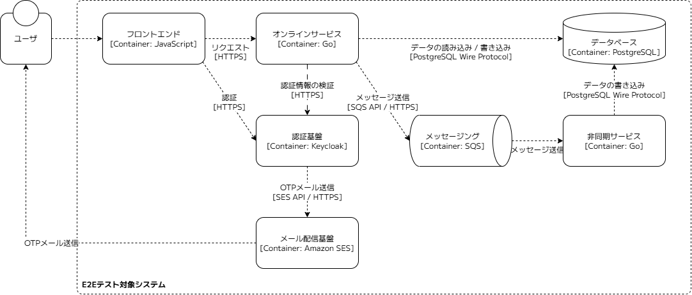
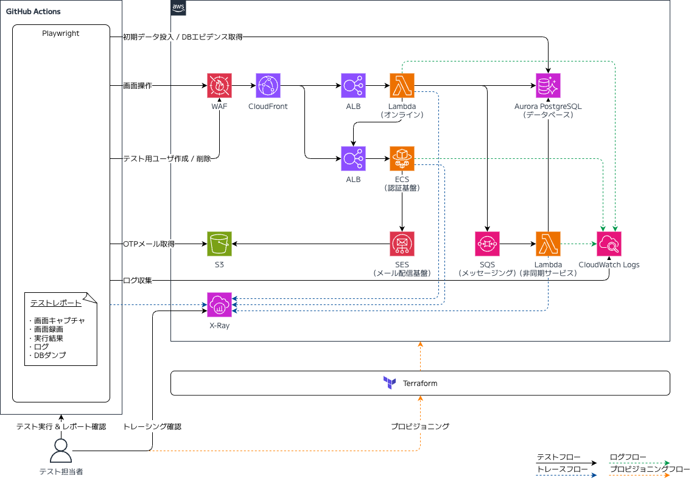
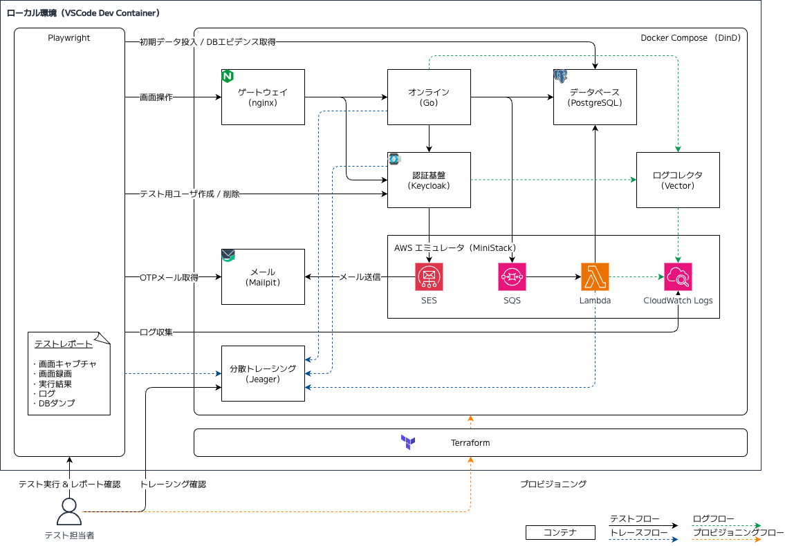
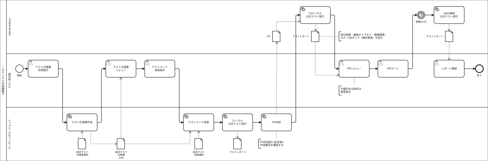
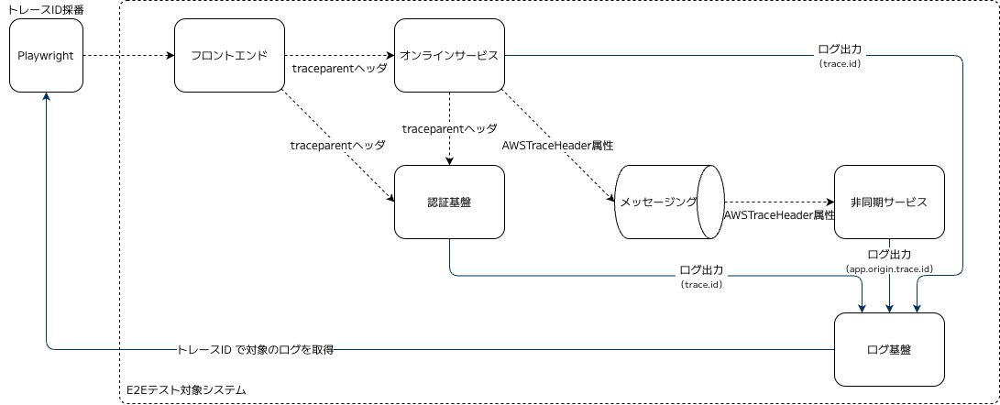

# E2E テストのフィードバックループを小さくするためのプラクティス

## はじめに

従来、E2E テストはテストピラミッドの頂点に置かれ、実行が遅く不安定なためテストケース数は必要最低限にする（ユニットテストやインテグレーションテストよりも少なくする）、というのがセオリーでした。しかしながら昨今、コーディングエージェントの進化により、従来のユニットテスト中心のテスト戦略から E2E テスト中心の戦略へとシフトする考え方が広がりつつあります。

ただし、テストのフィードバックループを小さくすることはこれまでと変わらず重要です。相対的にフィードバックループが大きいとされている E2E テストの重要度が上がっていくならこれはなおさらです。

言わずもがな、コーディングエージェントや Playwright などのテスト自動化ツールの登場で、E2E テストの実装にかかる時間は劇的に短くなりました。フィードバックループの中にはこれらも含まれますが、この記事で扱うのはテスト基盤にフォーカスしたプラクティスです。具体的には、次の 4 つの取り組みを紹介します。

- デプロイレスのテスト実行
- 自己完結型のテストレポート
- 分散トレーシング
- テストの並列化

## E2E テストの定義

E2E テストという言葉は、人によって解釈が違うので注意が必要です。この記事が前提としているのは、Web ブラウザを操作して画面から入力し、サーバを経由してデータベースに書き込まれた結果まで検証する、Web フロントエンドの E2E テストです。Web API のエンドポイントを直接コールするテストやモバイルアプリケーションのテストではありません。ただし、Web フロントエンドの E2E テストに限らず通用する考え方も含まれます。

## フィードバックループとは

テストによるフィードバックループとは、コードの実装からテストの実行と結果の確認を経て、失敗していれば原因を調べて修正し、もう一度実行するまでの一連の流れのことです。このループが小さいほど、1 回のテストで確かめる変更を小さく刻むことができ、リグレッションにすぐ気付けます。

このうち、テストコードを作成し変更する時間は、コーディングエージェントによって劇的に短くなりました。その結果、フィードバックループの大部分を占めるものは、テストコードの実装から次のような部分へシフトしつつあります。

- **テストが動作する環境を用意する時間**  
  E2E テストは、アプリケーションや認証基盤、データベースなどをそろえた環境で動作することが前提となります。これらはクラウド上に用意されるため、変更のたびにデプロイし、反映を待ってからでないとテストを実行できません。

- **実行結果を見て品質の確からしさを人が判断する時間**  
  E2E テストのコードをコーディングエージェントが実装する場合、単純に実行をパスしただけで本当に品質が担保できるのでしょうか。そもそも期待するアサーションが記述されているか、E2E の操作として表示される画面の見た目や文言は想定どおりか、テストの実行前後でデータベースの状態は期待どおりに変わっているか、といった人間によるゲートチェックは多かれ少なかれ必要です。

- **不具合の原因を特定し再検証する時間**  
  E2E テストの失敗は、クライアントサイドアプリケーション、オンラインサービス、データベースのどの階層で発生したとしても、テスト結果としては失敗として現れます。原因を特定するにはそれぞれのログや状態を突き合わせる必要があります。原因を特定し修正したあとは、もう一度アプリケーションをデプロイして反映を待ち、テストを回し直す必要があります。

ユニットテストであれば秒単位ですが、E2E テストではこれが分単位、時間単位になります。

## システム概要

今回取り上げるプラクティスはある特定のシステム構成に依存しませんが、具体的に話をイメージしやすいよう E2E テストの対象となるシステムについて目線を合わせておきます。私が実際の現場で取り扱ったシステムをもとに簡略化したものと考えてください。

システムは、図に示す 7 つの要素で構成されます。

- **フロントエンドアプリケーション**  
  利用者がブラウザから操作する UI を提供します

- **オンラインサービス**  
  画面からの要求を受け付け、認証情報を検証し、データベースを読み書きします

- **データベース**  
  アプリケーションのデータを保存します

- **認証基盤**  
  ユーザ ID とパスワードによる認証、ワンタイムパスワード（OTP）による認証を行います

- **メッセージング**  
  オンラインサービスのイベントを非同期サービスへ渡します

- **非同期サービス**  
  イベントを受け取り、データベースへ書き込みます

- **メール配信基盤**  
  OTP メールを送信します

一言で言えば、ログインにおいて二要素認証（パスワード認証 + OTP 認証）を必要とし、書き込みの一部を非同期で実施する、ごく一般的な Web アプリケーションです。

## ① デプロイレスのテスト実行

E2E テストをアプリケーションがデプロイされるクラウド環境だけでなく、ローカル環境でも実行できるようにするのは有効なアプローチです。開発者とコーディングエージェントのどちらも、コードを修正すると同時に E2E テストを実行できるので、アプリケーションをデプロイして反映を待つ時間がループから消えます。

### クラウド環境

GitHub Actions のランナーからデプロイ済みのクラウド環境へ向けて Playwright を実行する構成です。ブラウザからのリクエストは WAF, CloudFront, ALB を経由して Lambda（オンラインサービス）に到達し、Aurora（データベース）の読み書きやメッセージング（SQS）へのイベント送信を実施します。テストに必要なデータは、前処理として Keycloak（認証基盤）の Admin API と RDS Data API 経由で投入しています。

この環境は Terraform でプロビジョニングしています。構成はプロダクション環境とほぼ同じで、違いは OTP メールの扱いだけです。Playwright のテストコードから OTP を読めるよう、テスト用ドメイン宛てのメールを SES の受信ルールで S3 のバケットに保存しています。

これだけでも E2E テストの自動化は実現できます。ただし、テストを実行するたびにアプリケーションをクラウド環境へデプロイしなければなりません。

### ローカル環境

ローカル環境はクラウド環境と同じ構成を Docker Compose で再現しています。クラウド環境のコンポーネントとローカル環境のコンポーネントとの対応関係は次の通りです。

| 構成要素           | クラウド環境                      | ローカル環境                |
| ------------------ | --------------------------------- | --------------------------- |
| ゲートウェイ       | AWS WAF + Amazon CloudFront + ALB | nginx コンテナ              |
| オンラインサービス | AWS Lambda                        | Go コンテナ                 |
| データベース       | Amazon Aurora（PostgreSQL）       | PostgreSQL コンテナ         |
| 認証基盤           | Amazon ECS（Keycloak）            | Keycloak コンテナ           |
| メッセージング     | Amazon SQS                        | MiniStack                   |
| 非同期サービス     | AWS Lambda                        | MiniStack                   |
| メール配信基盤     | Amazon SES + Amazon S3            | mailpit コンテナ            |
| ログ               | Amazon CloudWatch Logs            | Vector コンテナ + MiniStack |
| トレーシング       | AWS X-Ray                         | Jaeger コンテナ             |

AWS のエミュレータには [MiniStack](https://ministack.org/) を使っています。この用途では長らく LocalStack が代表的でしたが、2026 年 3 月に無償の Community 版の提供がおわり、無償プランは非商用に限定されました（[LocalStack のお知らせ](https://blog.localstack.cloud/2026-upcoming-pricing-changes/)）。MiniStack は MIT ライセンスで公開されている代替ツールです。SQS から Lambda へのイベントソースマッピングや CloudWatch Logs へのログ連携などきめ細かい再現ができ、Terraform によるプロビジョニングも可能です。

テストコードは全環境共通で、接続先の切り替えは環境変数で制御します。ローカル環境で E2E テストが動くので、コーディングエージェントに実装を任せる場合も、エージェント自身が実装の中で E2E テストを実行できます。失敗すれば原因を自分で直して再実行し、自力で直せないときだけ人間に報告するという制御が可能です。

### テストのワークフロー

ローカル環境とクラウド環境の両方で E2E テストが動くことを前提に、実際にどのようなワークフローでテストを進めていたか紹介します。レーンは、テスト担当者、コーディングエージェント、GitHub Actions の 3 つです。

あくまで主要な部分のみをピックアップしていますが、全体の流れは次の通りです。

1. テスト担当者の指示で、コーディングエージェントが仕様書の規約に従ってテスト仕様書（Markdown 形式）を作成し、担当者がレビューする
2. テスト担当者の指示で、コーディングエージェントが仕様書と実装規約をもとにテストコードを実装し、ローカル環境で E2E テストを実行する
3. 失敗していればその場で不具合を修正（もしくは Issue を起票してスキップ）して、テストがパスするまで繰り返し、完了したら PR を作成する
4. PR をトリガに GitHub Actions がランナー上でローカル環境を構築（Docker Compose）して E2E テストを全件実行し、テストレポートを作成する
5. 担当者はテストレポートを見ながら PR をレビューし、不備があれば修正してマージする
6. 毎晩 02:00 に、GitHub Actions がマージ済みの develop ブランチからクラウド環境へ向けて全件 E2E テストを実行する

E2E テストが実行されるタイミングは 3 つあります。開発時および PR 時は、よりフィードバックループの小さいローカル環境の E2E テストを実行することで、即時に不具合を検知します。忠実性が高い（ただし実行時間もかかる）クラウド環境での E2E テストは日次で実行し、CDN や WAF など実際のインフラを通じて全体の動作を最終確認します。

|  #  | 実行場所                                | トリガ     | ブランチ                      |
| :-: | :-------------------------------------- | :--------- | :---------------------------- |
|  1  | コーディングエージェントのローカル環境  | 実装中随時 | 機能ブランチ（feature）       |
|  2  | GitHub Actions ランナーのローカル環境   | PR         | 機能ブランチ（feature）       |
|  3  | GitHub Actions ランナーからクラウド環境 | 日次       | デフォルトブランチ（develop） |

検出した不具合の数を比べると、ローカル環境の E2E テストがクラウド環境を大きく上回っていたため、開発中に多くの不具合を早期に検知し、修正できる結果となりました。

## ② 自己完結型のテストレポート

テストの実行結果やエビデンスを Playwright の HTML レポートに集約することで、テストの確からしさを人が判断する時間を短縮できます。いわゆる Human-in-the-Loop のためのアウトプットとなるものです。

レポートで確認できる情報は次の 6 種類です。担当者の確認は、このレポートで完結します。アサーションが期待どおりか、画面の見た目や文言が想定どおりか、データベースの状態が期待どおりに変わったかを、レポートの中で順に見ていきます。ステークホルダに対してテストのエビデンスの提出が求められる場合も、このレポートをそのまま渡すだけで、別途エビデンスを集める必要はありません。

| 情報                  | Playwright 標準 | 説明                                                                               |
| --------------------- | :-------------: | ---------------------------------------------------------------------------------- |
| 実行結果              |       〇        | テストごとの合否、所要時間、テストステップ、失敗したアサーションの一覧             |
| 画面キャプチャ        |       〇        | 検証した画面ごとのスクリーンショット                                               |
| 画面動画              |       〇        | テスト全体の操作の録画                                                             |
| Playwright のトレース |       〇        | 操作ごとの DOM とネットワークの記録（失敗したテストのみ）                          |
| データベースレコード  |                 | テストで状態が変わるテーブルの実行前後のレコード                                   |
| コンテナのログ        |                 | テストごとに集めた各コンテナ（オンラインサービス、認証基盤、非同期サービス）のログ |

Playwright 標準で提供されないデータベースレコードの添付やコンテナログの添付は、カスタムレポーターを作り込んで実現しています。

ログの集約には、このあと説明する分散トレーシングの伝播のしくみを利用しています。Playwright はテストごとに一意なトレース ID を払い出し、ブラウザから送るリクエストの `traceparent` ヘッダに載せます。受け取った値は、オンラインサービスから認証基盤、メッセージング、非同期サービスへと伝播し、各コンテナのログに出力されます。ログはすべて CloudWatch Logs に集約される[^1]ので、テストの終了後に Playwright がトレース ID をキーにログを検索し、テストごとにレポートへ添付します。

[The birth of the Software Verification Engineer](https://blog.reqproof.com/p/the-birth-of-the-software-verification) では、エージェントがコードとテストを書く時代には人の役割が検証のしくみ作りに移り、証拠は UI の変更なら操作の録画のように人がレビューしやすい形にまとめるべきだと述べています。このテストレポートも、その考え方に沿ったものです。

## ③ 分散トレーシング

テスト 1 件の処理の流れを、ブラウザの操作からオンラインサービス、認証基盤、メッセージングを経て非同期サービスに至るまで 1 本のトレースとして可視化することで、不具合の原因を特定する時間を短縮できます。トレースとは、処理の 1 区間を開始と終了の時刻、親子関係、属性とともに記録したスパンの集まりです。E2E テストの失敗原因を特定するには、どの区間で時間がかかり、どの呼び出しで失敗したかを把握しなければなりませんが、スパンの所要時間と親子関係を見ればその両方が分かります。

スパンを送っているのは次の 4 つです。

- **Playwright**  
  テストの開始時にルートスパンを作成し、終了時にテスト名と実行結果（成功/失敗）を付けて送ります。各サービスのスパンはこのルートスパンの子になります。

- **オンラインサービス**  
  リクエストごとにスパンを作成し、認証基盤の呼び出し、AWS サービスの呼び出し、データベースアクセスを子スパンとして記録します。

- **認証基盤**  
  リクエストごとにスパンを作成し、認証処理の内容を記録します。

- **非同期サービス**  
  起動ごとにスパンを作成し、AWS サービスの呼び出しとデータベースアクセスを子スパンとして記録します。ただし、このスパンはテストのトレースには含めず、別のトレースとして作成したうえでテストのトレースへリンクを張ります[^2]。

ローカル環境では、これらのスパンを OSS の分散トレーシング基盤である [Jaeger](https://www.jaegertracing.io/) に送ります。Jaeger は受け取ったスパンをトレース ID ごとに 1 本のトレースとして組み立てるので、テスト名を検索すると、ブラウザの操作からオンラインサービスの処理、認証基盤への呼び出し、イベントの送信までが 1 本のトレースとして並び、非同期サービスの処理はリンクをたどって開けます。失敗したテストのトレース ID はテストレポートに出力されるので、テストレポートからそのまま Jaeger の画面に遷移してトレースの詳細を確認できます。

クラウド環境では、スパンの送り先を CloudWatch の Transaction Search（X-Ray の OTLP エンドポイント）にしています。Lambda はコンテナイメージに同梱した OpenTelemetry Collector を、Keycloak は同じ ECS タスクのサイドカーとして動く ADOT Collector を経由して、X-Ray へ送ります。X-Ray はスパンを CloudWatch Logs のロググループ `aws/spans` に書き込むので、ログと同じ Logs Insights でトレースとログを突き合わせられます。

## ④ テストの並列化

E2E テストを並列に実行することで、テストケースが増えても実行時間の増加を抑えられます。Playwright は `workers` と `fullyParallel` の設定だけで、ファイルをまたいでもファイル内でもケースを並列に動かせます。

並列化するには、同時に走るテストどうしでデータがコンフリクトしないようにしなければなりません。ここはシステムの特性によって細かい設計が必要になるところです。今回のようにデータがユーザに紐づくシステムであれば、テストごとに前処理でユーザを作成し、後処理でそのユーザと、そのユーザに関連するデータを削除する運用がベースになるでしょう。

実測値としては GitHub Actions の 4 コアのランナーで約 160 件を 13 分程度の処理時間で実行できています。ただし、ランナーそのものの環境の構築に半分以上の時間がかかっているなど、まだ改善の余地はあります。並列化をさらに突き詰めた事例としては、[E2Eテストをユニットテスト並みの実行時間に — Playwright並列化とGitHub Actionsチューニングの実践](https://zenn.dev/berry_blog/articles/39392e1da7ca71) が参考になります。

## 補足：E2E テストを取り巻く議論

最後に、ここ最近の E2E テストを取り巻く議論について、個人的な見解を書いておきます。
ユニットテストのコードを全部やめて E2E に賭けるのが米国で流行しているのか、という趣旨の [X での投稿](https://x.com/fumisukekato/status/2103699369115734427) に端を発し、X の [トレンド](https://x.com/i/trending/2104077005151236134) にもなりました。論点はいくつかあると思っていますが、2 つに絞って整理します。

- **ユニットテストは不要もしくは最小限になるのか**  
  AI 時代は、運用コストが下がった E2E テストを厚くし、ユニットテストは精鋭化する（もしくはなくす）テストバランスが望ましい、という意見があります。
  たしかに、コーディングエージェントは自分でユニットテストを書いて自己検証するので、人間が細かく意思入れする必要性はほぼなくなったと思います。
  一方で、これまでのユニットテストをあえてなくしたり減らしたりする必要があるのかというと、それは違います。ユニットテストは高速に実行でき、CI との統合も簡単です。既存の実装の振る舞いが変わっていないことを確認するリグレッション検知として依然として有効なものです。

- **E2E テストは厚くすべきなのか**  
  これは Yes です。コーディングエージェントにより、E2E テストの実装とメンテナンスのコストは大きく下がりました。
  従来のテストピラミッドは、その実装コスト、実行速度、不確実性の高さから E2E テストを薄くすべきだ、という考えで組み立てられたものです。コストが大きく下がるのであれば E2E テストの割合が増えるのは、テストピラミッドの原則に照らしても自然です。

## おわりに

E2E テストのフィードバックループを小さくするために、デプロイレスのテスト実行、自己完結型のテストレポート、分散トレーシング、テストの並列化の 4 つを紹介しました。コーディングエージェントの普及で E2E テストの自動化はこれからますます広がっていくと思われるので、今回紹介したようなアプローチはより重要になっていくでしょう。

[^1]: ローカル環境では [Vector](https://vector.dev/) を利用してコンテナのログを MiniStack の CloudWatch Logs に集約しています。

[^2]: OpenTelemetry のメッセージングのセマンティック規約では、キューから取り出したメッセージを処理するスパンは送信側のトレースの子にせず、リンクで結ぶことが [推奨されています](https://opentelemetry.io/docs/specs/semconv/messaging/messaging-spans/#message-creation-context-as-parent-of-process-span)。Lambda は 1 回の起動で複数のメッセージを処理することがあり、親を 1 つに決められないためです。非同期サービスのログで、Playwright が採番したトレース ID を `trace.id` ではなく `app.origin.trace.id` という別の属性として出力しているのもこのためで、`trace.id` には Lambda 側のトレースの値が入ります。
