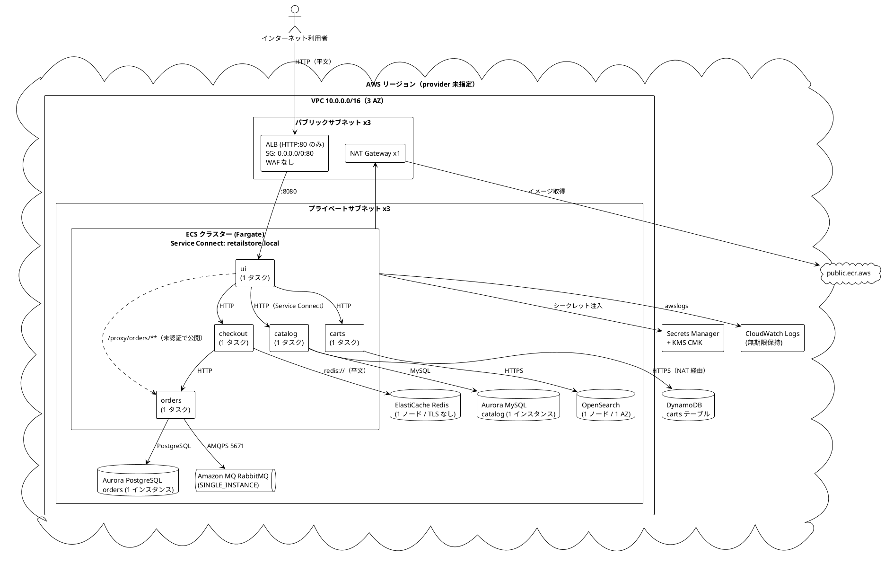

# Well-Architected Review: retail-store-ecs

> **Classification: CONFIDENTIAL** — 本報告書にはインフラの詳細と未対応のセキュリティ上の指摘が含まれます。配布は権限のある関係者に限定し、明示の承認なく広く閲覧可能なチャンネルやチケットシステムに掲載しないでください。

## Coverage Audit

- 評価済み BP: 307 / 307
- フレームワーク版の取得元: ACQUIRE_CORPUS によるライブドキュメント
- コーパスの出典: https://docs.aws.amazon.com/wellarchitected/latest/framework/toc-contents.json（取得 2026-10-20T14:41:55Z UTC、HTTPS 取得）
- 柱: 6 · 質問: 57 · ベストプラクティス: 307
- 状態の分布: Implemented 30 / Partially Implemented 103 / Not Implemented 98 / Not Applicable 14 / Cannot Determine 62
- 補足: SUS01 の質問ページは TOC 上で非標準の href（`w2aac19c17b7b5.html`）だったため、質問タイトル（`SUS 1 ...`）で照合した。BP ID はすべて TOC からそのまま取得し、推測で補った ID はない

| 柱 | BP 評価数 | 状態 (I / P / N / NA / CD) | リスク (Critical / High / Medium / Low) |
|----|-----------|----------------------------|------------------------------------------|
| 運用上の優秀性 (OPS) | 68/68 | 6 / 22 / 18 / 0 / 22 | 0 / 1 / 10 / 29 |
| セキュリティ (SEC) | 63/63 | 3 / 21 / 23 / 2 / 14 | 2 / 4 / 14 / 24 |
| 信頼性 (REL) | 65/65 | 8 / 26 / 22 / 6 / 3 | 0 / 3 / 17 / 28 |
| パフォーマンス効率 (PERF) | 32/32 | 7 / 11 / 10 / 2 / 2 | 0 / 0 / 4 / 17 |
| コスト最適化 (COST) | 50/50 | 2 / 12 / 21 / 1 / 14 | 0 / 0 / 6 / 27 |
| 持続可能性 (SUS) | 29/29 | 4 / 11 / 4 / 3 / 7 | 0 / 0 / 1 / 14 |

## Executive Summary

- **日付**: 2026-10-20
- **ワークロード**: retail-store-ecs（AWS Containers Retail Sample の ECS/Fargate デプロイ構成）
- **ビジネス上の重要度**: standard
- **適用レンズ**: General（レンズ固有の評価は対象外）
- **分析対象**: `terraform/ecs/default`、そこから呼ばれる `terraform/lib/{tags,vpc,dependencies,ecs,ecs/service,images}`、`.github/workflows`（6 ファイル）と `.github/actions`、`src/{ui,cart,orders,catalog,checkout,e2e,load-generator,misc,app}`、および補助的に `renovate.json`・`lefthook.yml`・`docs/features.md`
- **評価した質問数**: 57/57（ライブドキュメントの質問数）
- **指摘件数（BP 単位）**: Critical 2、High 8、Medium 52、Low 139
- **指摘件数（統合後の論点単位）**: Critical 1、High 4、Medium 15、Low 12（下記「リスク別の指摘」）
- **総合成熟度**: 2.5 / 5 — IaC・CI・マネージドサービス・暗号化の基盤は整っている。一方で、公開経路に未認証の内部 API と障害注入エンドポイントが露出している。さらに HTTPS・WAF・アラームがなく、全コンポーネントが単一インスタンスで動いている

**総評**: AWS 公式サンプルらしく、構成要素の選択は筋が良い。サービスはドメイン別に分割され、用途別データストアとマネージドサービスで構成されている。認証情報は Secrets Manager から注入され、CI は OIDC を使い、E2E とトレース検証も CI 化されている。ただし、このコードをそのまま `terraform apply` すると、インターネット向け ALB（HTTP のみ・WAF なし）の背後で UI が `/proxy/orders/**` と `/utility/*` を未認証のまま公開する。前者からは全注文の氏名・メール・住所を取得でき、後者の `/utility/panic` は GET 1 回で唯一の UI タスクを停止させる。standard の重要度でも本番トラフィックを受ける前に必ず塞ぐべき問題であり、これが唯一の Critical である。その次に優先すべきは、HTTPS 化と WAF、アラームと通知の整備、ECS タスクの最小 2 台化とデプロイサーキットブレーカーの 4 点で、いずれも 1 週間以内に着手できる。

**主な強み**

- ドメイン駆動のサービス分割とサービスごとの専用データストア（REL03-BP01/02、SUS03-BP05）
- Fargate とマネージドデータストアの全面採用による管理範囲の縮小（SEC01-BP05、SUS05-BP03）
- DB/MQ/OpenSearch の認証情報を Secrets Manager から `secrets` で注入（`terraform/lib/ecs/catalog.tf:23-29`、`orders.tf:23-31`）
- GitHub Actions の OIDC による一時認証（`.github/workflows/artifacts.yaml:34-39`）
- PR での lint・テスト・tflint、docker compose と kind での E2E、トレース伝搬のアサーション（`.github/workflows/e2e-test.yml:51-55`）
- release-please と Conventional Commits による小さく頻繁なリリース、Renovate の `minimumReleaseAge: 14 days` によるサプライチェーン対策
- Aurora・OpenSearch の保存時暗号化、OpenSearch の HTTPS 強制、MQ の AMQPS（5671）

## Architecture Overview



**構成の要点**

- **入口**: インターネット向け ALB（`terraform/lib/ecs/alb.tf`）が HTTP:80 で UI のターゲットグループ（`/actuator/health`）に転送する。ACM 証明書・HTTPS リスナー・WAF はない。
- **アプリ層**: 5 サービスが共通モジュール `terraform/lib/ecs/service` で同一パターン（Fargate、1vCPU/2GB、`desired_count = 1`、ECS Exec 有効、Service Connect）で構築される。オプションで CloudWatch エージェントのサイドカー（OTLP→X-Ray）が付く。
- **データ層**: catalog は Aurora MySQL と OpenSearch、carts は DynamoDB（Gateway エンドポイントがないため NAT 経由）、checkout は ElastiCache Redis、orders は Aurora PostgreSQL と Amazon MQ。いずれもプライベートサブネットにあり、SG 参照でアクセス元を限定している。
- **信頼境界**: インターネット ↔ ALB（平文 HTTP）、ALB ↔ ECS タスク（タスク SG は 0.0.0.0/0:8080 を許可）、タスク ↔ データ層（SG 参照）。サービス間通信には認証も TLS もない。
- **CI/CD**: GitHub Actions はイメージのビルドと ECR Public への公開（マルチアーキテクチャ）、Helm チャート・compose・k8s マニフェストの配布までを担う。ECS 環境へのデプロイはローカルからの手動 `terraform apply` で、state はローカル（backend 未定義）。
- **アプリの特徴**: Java 21 / Spring Boot 3.5（ui, cart, orders）、Go 1.25 / Gin（catalog）、NestJS 11 / Node 20（checkout）。OTel 計装と Prometheus メトリクスは実装済みだが、ECS では既定で無効。各サービスに `/chaos/*`、UI に `/utility/*` の障害注入・運用エンドポイントがある。

## Pillar Scorecard

| 柱 | スコア (1-5) | 評価した質問 | 主な強み | 主なギャップ |
|----|-------------|-------------|---------|-------------|
| 運用上の優秀性 | 2.5 | 11/11 | PR CI・E2E・release-please・Renovate による変更フロー、共通モジュール | アラームが皆無、ECS デプロイの手動実行とロールバックなし、ログが非構造化 |
| セキュリティ | 2.0 | 11/11 | Secrets Manager 注入、OIDC、プライベートサブネット、Aurora/OpenSearch の暗号化 | 未認証の PII 露出と障害注入エンドポイント、HTTP のみ、WAF なし、Redis 平文 |
| 信頼性 | 2.0 | 13/13 | ドメイン分割、3 AZ ネットワーク、ECS の自動置換、不変イメージ | 全コンポーネントが単一インスタンス、通知なし、タイムアウト・冪等性の不備 |
| パフォーマンス効率 | 3.0 | 5/5 | 用途別データストア、Fargate、Container Insights enhanced | 一律サイズ、Auto Scaling なし、実質的な負荷試験なし |
| コスト最適化 | 2.5 | 11/11 | マネージドサービスと OSS エンジン、IaC による一括作成・削除 | Budgets・異常検知なし、コスト配分タグ不足、ログ無期限保持 |
| 持続可能性 | 3.0 | 6/6 | マネージドサービス中心、OpenSearch は Graviton | 需要追従スケーリングなし、ARM64 未活用、データのライフサイクル管理なし |

評価した質問の分母は ACQUIRE_CORPUS で取得したライブの質問数である。

## Per-Question Assessment

質問の状態は配下の BP から次の規則で導いた。評価可能な BP（NA・CD を除く）がすべて Implemented なら Implemented、すべて Not Implemented なら Not Implemented、それ以外は Partially Implemented とする。ただし、リスクを伴う BP がなく、Cannot Determine の BP が評価可能な BP より多い質問は Cannot Determine とする。リスクは配下 BP の最大値を採る。

| ID | 質問 | 状態 | リスク | 主な根拠 (BP 内訳 I/P/N/NA/CD) |
|----|------|------|--------|------|
| COST01 | COST 1. How do you implement cloud financial management? | Partially Implemented | Medium | Budgets・異常検知なし（I0/P1/N3/NA0/CD5） |
| COST02 | COST 2. How do you govern usage? | Partially Implemented | Low | 環境タグのみ。コスト統制なし（I0/P1/N1/NA0/CD4） |
| COST03 | COST 3. How do you monitor your cost and usage? | Partially Implemented | Low | コスト配分タグが不足、provider default_tags なし（I0/P2/N2/NA0/CD2） |
| COST04 | COST 4. How do you decommission resources? | Partially Implemented | Medium | ロググループ無期限保持、廃止手順なし（I0/P2/N3/NA0/CD0） |
| COST05 | COST 5. How do you evaluate cost when you select services? | Partially Implemented | Low | マネージド中心。MQ m5.large は過大の可能性（I1/P3/N1/NA0/CD1） |
| COST06 | COST 6. How do you meet cost targets when you select resource type, size and number? | Partially Implemented | Medium | データに基づくサイジング・自動スケーリングなし（I0/P1/N3/NA0/CD0） |
| COST07 | COST 7. How do you use pricing models to reduce cost? | Not Implemented | Low | Savings Plans / Fargate Spot 未検討（I0/P0/N2/NA1/CD2） |
| COST08 | COST 8. How do you plan for data transfer charges? | Partially Implemented | Low | VPC エンドポイントなし、単一 NAT（I0/P1/N2/NA0/CD0） |
| COST09 | COST 9. How do you manage demand, and supply resources? | Partially Implemented | Medium | MQ による非同期化あり、動的供給なし（I0/P1/N2/NA0/CD0） |
| COST10 | COST 10. How do you evaluate new services? | Not Implemented | Low | 定期レビューなし（I0/P0/N2/NA0/CD0） |
| COST11 | COST 11. How do you evaluate the cost of effort? | Implemented | Not Applicable | IaC と Renovate で運用自動化（I1/P0/N0/NA0/CD0） |
| OPS01 | OPS 1. How do you determine what your priorities are? | Not Implemented | Medium | 優先度・コンプライアンス要件の記録なし。決済フォームと PII を扱う（I0/P0/N3/NA0/CD3） |
| OPS02 | OPS 2. How do you structure your organization to support your business outcomes? | Partially Implemented | Low | タグは environment-name / created-by のみ (`terraform/lib/tags/main.tf:7-10`)（I0/P3/N0/NA0/CD3） |
| OPS03 | OPS 3. How does your organizational culture support your business outcomes? | Cannot Determine | Not Applicable | 組織文化はコード外。chaos エンドポイントで実験を促進（I1/P0/N0/NA0/CD6） |
| OPS04 | OPS 4. How do you implement observability in your workload? | Partially Implemented | Medium | Prometheus・OTel は実装済みだが ECS では既定無効 (`terraform/ecs/default/variables.tf:21-25`, `terraform/lib/ecs/service/ecs.tf:23-24`)（I0/P3/N2/NA0/CD0） |
| OPS05 | OPS 5. How do you reduce defects, ease remediation, and improve flow into production? | Partially Implemented | Medium | PR CI・E2E・release-please・Renovate は成熟。ECS デプロイは手動 apply、リモート state なし（I5/P5/N0/NA0/CD0） |
| OPS06 | OPS 6. How do you mitigate deployment risks? | Partially Implemented | Medium | ECS のデプロイサーキットブレーカー/ロールバックなし (`terraform/lib/ecs/service/ecs.tf:136-175`)（I0/P2/N2/NA0/CD0） |
| OPS07 | OPS 7. How do you know that you are ready to support a workload? | Partially Implemented | Low | README のデプロイ手順のみ。ランブック・ORR なし（I0/P2/N2/NA0/CD2） |
| OPS08 | OPS 8. How do you utilize workload observability in your organization? | Partially Implemented | High | CloudWatch アラームが皆無。ログは非構造化・無期限保持（I0/P4/N1/NA0/CD0） |
| OPS09 | OPS 9. How do you understand the health of your operations? | Not Implemented | Low | 運用 KPI・レビューなし（I0/P0/N3/NA0/CD0） |
| OPS10 | OPS 10. How do you manage workload and operations events? | Not Implemented | Low | アラーム・イベント自動応答なし (`terraform/lib/ecs/eventbridge.tf:18-36` は既定無効)（I0/P0/N4/NA0/CD3） |
| OPS11 | OPS 11. How do you evolve operations? | Partially Implemented | Low | CHANGELOG はあるが README と実装に乖離（I0/P3/N1/NA0/CD5） |
| PERF01 | PERF 1. How do you select appropriate cloud resources and architecture for your workload? | Partially Implemented | Low | 現行サービスとリファレンスモジュールを採用。ベンチマークなし（I3/P1/N3/NA0/CD0） |
| PERF02 | PERF 2. How do you select and use compute resources in your workload? | Partially Implemented | Medium | Fargate 採用。一律 1vCPU/2GB、Auto Scaling なし、ARM64 未使用（I2/P1/N2/NA1/CD0） |
| PERF03 | PERF 3. How do you store, manage, and access data in your workload? | Partially Implemented | Low | 用途別データストア。catalog の接続プール未設定、Performance Insights なし（I1/P4/N0/NA0/CD0） |
| PERF04 | PERF 4. How do you select and configure networking resources in your workload? | Partially Implemented | Low | ALB + Service Connect。HTTPS/HTTP2 なし（I1/P2/N1/NA1/CD2） |
| PERF05 | PERF 5. How do your organizational practices and culture contribute to performance efficiency in your workload? | Partially Implemented | Medium | 負荷試験は 1 到着のスモークのみ、性能 KPI なし（I0/P3/N4/NA0/CD0） |
| REL01 | REL 1. How do you manage Service Quotas and constraints? | Not Implemented | Low | クォータ管理なし（I0/P0/N3/NA2/CD1） |
| REL02 | REL 2. How do you plan your network topology? | Partially Implemented | Low | 3 AZ・/16 VPC で拡張余地あり（I1/P2/N0/NA2/CD0） |
| REL03 | REL 3. How do you design your workload service architecture? | Implemented | Not Applicable | ドメイン別マイクロサービスと OpenAPI 契約（I3/P0/N0/NA0/CD0） |
| REL04 | REL 4. How do you design interactions in a distributed system to prevent failures? | Partially Implemented | Medium | MQ で疎結合だがキュー非永続・アウトボックスなし、冪等性なし（I1/P1/N1/NA1/CD0） |
| REL05 | REL 5. How do you design interactions in a distributed system to mitigate or withstand failures? | Partially Implemented | Medium | タイムアウト未設定 (checkout→orders)、リトライ実装不備、レート制限なし（I1/P4/N2/NA0/CD0） |
| REL06 | REL 6. How do you monitor workload resources? | Partially Implemented | High | Container Insights あり、アラーム・通知なし（I0/P3/N4/NA0/CD0） |
| REL07 | REL 7. How do you design your workload to adapt to changes in demand? | Partially Implemented | Medium | Auto Scaling なし、desired_count=1（I1/P1/N2/NA0/CD0） |
| REL08 | REL 8. How do you implement change? | Partially Implemented | Medium | 不変イメージ・E2E は良好。ECS デプロイは手動（I1/P2/N2/NA0/CD0） |
| REL09 | REL 9. How do you back up data? | Partially Implemented | Medium | Aurora 自動バックアップのみ、DynamoDB PITR なし、skip_final_snapshot=true（I0/P3/N1/NA0/CD0） |
| REL10 | REL 10. How do you use fault isolation to protect your workload? | Partially Implemented | High | 3 AZ のネットワークだが、タスク・DB・MQ・OpenSearch・Redis・NAT が単一（I0/P3/N0/NA0/CD0） |
| REL11 | REL 11. How do you design your workload to withstand component failures? | Partially Implemented | High | フェイルオーバー先なし、可用性イベント通知なし（I0/P3/N3/NA0/CD1） |
| REL12 | REL 12. How do you test reliability? | Partially Implemented | Low | chaos エンドポイントはあるが体系的な実験・ゲームデイなし（I0/P2/N2/NA0/CD1） |
| REL13 | REL 13. How do you plan for disaster recovery (DR)? | Partially Implemented | Medium | RTO/RPO 未定義。IaC で再構築は可能（I0/P2/N2/NA1/CD0） |
| SEC01 | SEC 1. How do you securely operate your workload? | Partially Implemented | High | マネージドサービス中心で管理範囲は小さいが、脅威モデルと WAF なし（I1/P1/N3/NA0/CD3） |
| SEC02 | SEC 2. How do you manage authentication for people and machines? | Partially Implemented | Medium | OIDC・タスクロール・Secrets Manager 注入は良好。ローテーションなし、Redis AUTH なし（I1/P1/N2/NA0/CD2） |
| SEC03 | SEC 3. How do you manage permissions for people and machines? | Partially Implemented | Critical | 公開 UI の `/proxy/orders/**` から全注文 PII を未認証取得可能。`dynamodb:*`（I0/P2/N2/NA2/CD3） |
| SEC04 | SEC 4. How do you detect and investigate security events? | Partially Implemented | Medium | ALB アクセスログ・VPC Flow Logs・DB 監査ログなし（I0/P2/N1/NA0/CD1） |
| SEC05 | SEC 5. How do you protect your network resources? | Partially Implemented | High | サブネット分離は良好。タスク SG 8080 が 0.0.0.0/0、WAF なし（I1/P1/N2/NA0/CD0） |
| SEC06 | SEC 6. How do you protect your compute resources? | Partially Implemented | Medium | Fargate・非 root。イメージスキャンなし、readonlyRootFilesystem=false、Node 20 EOL（I0/P4/N1/NA0/CD0） |
| SEC07 | SEC 7. How do you classify your data? | Not Implemented | Critical | データ分類なし。PII を stdout に出力（I0/P0/N4/NA0/CD0） |
| SEC08 | SEC 8. How do you protect your data at rest? | Partially Implemented | Medium | Aurora/OpenSearch は暗号化。ElastiCache 保存時暗号化なし、KMS ローテーションなし（I0/P4/N0/NA0/CD0） |
| SEC09 | SEC 9. How do you protect your data in transit? | Partially Implemented | High | ALB は HTTP のみ (`terraform/lib/ecs/alb.tf:28-34`)、Redis 平文 (`elasticache.tf:9`)（I0/P1/N2/NA0/CD0） |
| SEC10 | SEC 10. How do you anticipate, respond to, and recover from incidents? | Not Implemented | Low | インシデント対応計画・プレイブックなし（I0/P0/N5/NA0/CD3） |
| SEC11 | SEC 11. How do you incorporate and validate the security properties of applications throughout the design, development, and deployment lifecycle? | Partially Implemented | Medium | lint/テスト/tflint は CI 化。SAST・依存/IaC スキャンなし（I0/P5/N1/NA0/CD2） |
| SUS01 | SUS 1 How do you select Regions for your workload? | Cannot Determine | Not Applicable | リージョン指定なし（実行環境依存）（I0/P0/N0/NA0/CD1） |
| SUS02 | SUS 2 How do you align cloud resources to your demand? | Partially Implemented | Medium | Auto Scaling なし、MQ による平準化あり（I0/P2/N1/NA0/CD3） |
| SUS03 | SUS 3 How do you take advantage of software and architecture patterns to support your sustainability goals? | Partially Implemented | Low | 用途別データストア、一律サイズ（I1/P2/N0/NA0/CD2） |
| SUS04 | SUS 4 How do you take advantage of data management policies and patterns to support your sustainability goals? | Partially Implemented | Low | ログ・カートのライフサイクル管理なし（I1/P3/N3/NA1/CD0） |
| SUS05 | SUS 5 How do you select and use cloud hardware and services in your architecture to support your sustainability goals? | Partially Implemented | Low | マネージド中心。Graviton は OpenSearch のみ（I1/P2/N0/NA1/CD0） |
| SUS06 | SUS 6 How do your organizational processes support your sustainability goals? | Partially Implemented | Low | Renovate による更新、エージェントは latest（I1/P2/N0/NA1/CD1） |

## Full BP Ledger (MANDATORY)

各柱の評価表を、柱順・BP ID 順に連結した全 307 行の台帳である（マニフェストの 307 件と一致）。

| BP ID | 柱 | 状態 | リスク | 根拠 | 推奨事項 |
|-------|----|------|--------|------|----------|
| OPS01-BP01 | 運用上の優秀性 | Cannot Determine |  | 外部顧客ニーズの評価はコード外 | ヒアリングで確認 |
| OPS01-BP02 | 運用上の優秀性 | Cannot Determine |  | 内部顧客ニーズの評価はコード外 | ヒアリングで確認 |
| OPS01-BP03 | 運用上の優秀性 | Cannot Determine |  | ガバナンス要件の記録なし | ヒアリングで確認 |
| OPS01-BP04 | 運用上の優秀性 | Not Implemented | Medium | 決済フォーム・個人情報を扱うが、コンプライアンス要件（PCI DSS、個人情報保護法等）の評価記録なし | 適用規制を特定し、要件を設計に反映する |
| OPS01-BP05 | 運用上の優秀性 | Not Implemented | Low | 脅威状況の評価なし（SEC01-BP07 と同根） | 脅威モデリングを実施する |
| OPS01-BP06 | 運用上の優秀性 | Not Implemented | Low | 単一 NAT・単一インスタンス等のトレードオフ判断の記録なし | ADR として記録する |
| OPS02-BP01 | 運用上の優秀性 | Partially Implemented | Low | タグは `environment-name`・`created-by` のみ (`terraform/lib/tags/main.tf:7-10`)。オーナータグなし | `owner`・`team` タグを追加する |
| OPS02-BP02 | 運用上の優秀性 | Cannot Determine |  | プロセスのオーナーはコード外 | ヒアリングで確認 |
| OPS02-BP03 | 運用上の優秀性 | Cannot Determine |  | 運用活動のオーナーはコード外 | ヒアリングで確認 |
| OPS02-BP04 | 運用上の優秀性 | Partially Implemented | Low | `CONTRIBUTING.md`、PR テンプレート的な semantic PR チェック (`.github/workflows/pr.yaml:16-22`) | CODEOWNERS を追加する |
| OPS02-BP05 | 運用上の優秀性 | Partially Implemented | Low | GitHub の PR/Issue で変更要求を受付 (`.github/workflows/pr.yaml`) | 現状維持 |
| OPS02-BP06 | 運用上の優秀性 | Cannot Determine |  | チーム間責任分担はコード外 | ヒアリングで確認 |
| OPS03-BP01 | 運用上の優秀性 | Cannot Determine |  | 経営層の支援はコード外 | ヒアリングで確認 |
| OPS03-BP02 | 運用上の優秀性 | Cannot Determine |  | 組織文化はコード外 | ヒアリングで確認 |
| OPS03-BP03 | 運用上の優秀性 | Cannot Determine |  | 組織文化はコード外 | ヒアリングで確認 |
| OPS03-BP04 | 運用上の優秀性 | Cannot Determine |  | コミュニケーション手段はコード外 | ヒアリングで確認 |
| OPS03-BP05 | 運用上の優秀性 | Implemented |  | chaos エンドポイントや機能フラグ（テーマ、チャットボット）で実験を促す設計 (`docs/features.md`) | 現状維持 |
| OPS03-BP06 | 運用上の優秀性 | Cannot Determine |  | スキル育成はコード外 | ヒアリングで確認 |
| OPS03-BP07 | 運用上の優秀性 | Cannot Determine |  | 要員配置はコード外 | ヒアリングで確認 |
| OPS04-BP01 | 運用上の優秀性 | Not Implemented | Medium | KPI（注文成功率、チェックアウト完了率等）の定義なし | ビジネス KPI と技術 KPI を定義する |
| OPS04-BP02 | 運用上の優秀性 | Partially Implemented | Medium | 各サービスに Prometheus メトリクス・ヘルスエンドポイントあり (`src/catalog/main.go:113-114`, `src/checkout/src/app.module.ts:41`)。ECS 構成ではメトリクスエクスポートなし (`terraform/lib/ecs/service/ecs.tf:23-24`)、ログは非構造化 | CloudWatch エージェントで Prometheus メトリクスを収集し、JSON ログに切り替える |
| OPS04-BP03 | 運用上の優秀性 | Not Implemented | Low | RUM 等のユーザー体験テレメトリなし | CloudWatch RUM または Synthetics canary を導入する |
| OPS04-BP04 | 運用上の優秀性 | Partially Implemented | Low | OTel の自動計装で DB/DynamoDB/HTTP の依存スパンを取得 (`src/catalog/repository/repository.go:61`)。既定無効 | トレースを既定で有効化する |
| OPS04-BP05 | 運用上の優秀性 | Partially Implemented | Medium | 分散トレーシング実装済み（X-Ray 互換 ID、W3C 伝搬 `src/catalog/main.go:194-211`、ECS の CloudWatch エージェントサイドカー `terraform/lib/ecs/service/ecs.tf:84-115`）。ただし `opentelemetry_enabled` 既定 false (`terraform/ecs/default/variables.tf:21-25`) | 既定 true にし、Application Signals の利用を検討する |
| OPS05-BP01 | 運用上の優秀性 | Implemented |  | Git・GitHub で全コードと IaC を管理 | 現状維持 |
| OPS05-BP02 | 運用上の優秀性 | Partially Implemented | Medium | PR でビルド・lint・テスト (`.github/workflows/pr.yaml:39-57`)、E2E (`e2e-test.yml`)。Terraform は `terraform validate` のみ (`terraform/ecs/default/project.json` test)、lint は `exit 0`。checkout に単体テストなし（`src/checkout/package.json:18` `exit 0`） | PR で `terraform plan` を実行し差分をレビューする。checkout の単体テストを追加する |
| OPS05-BP03 | 運用上の優秀性 | Implemented |  | 設定は Terraform 変数・環境変数・Secrets Manager で管理 (`terraform/lib/ecs/service/variables.tf:42-52`) | 現状維持 |
| OPS05-BP04 | 運用上の優秀性 | Partially Implemented | Medium | ビルド・イメージ公開は自動化 (`.github/workflows/artifacts.yaml`, `release-please.yml`)。ECS デプロイは手動。リモート state・`.terraform.lock.hcl` なし (`terraform/ecs/default/`) | S3 backend とロックファイルをコミットし、デプロイをパイプライン化する |
| OPS05-BP05 | 運用上の優秀性 | Partially Implemented | Low | Renovate 自動マージ (`renovate.json:3`)、Dockerfile で `dnf upgrade` (`src/ui/Dockerfile:30`)、MQ の自動マイナーアップグレード (`mq.tf:23`)。CloudWatch エージェントは `:latest` 固定なし | エージェントをバージョン固定し Renovate 管理下に置く |
| OPS05-BP06 | 運用上の優秀性 | Implemented |  | 共通サービスモジュール (`terraform/lib/ecs/service`)、Checkstyle 共有 (`src/misc/style/java/checkstyle.xml`)、`DEVELOPER_GUIDE.md` | 現状維持 |
| OPS05-BP07 | 運用上の優秀性 | Implemented |  | lefthook による prettier/gofmt/terraform fmt/tflint (`lefthook.yml` pre-commit-ci)、PR での実行 (`.github/workflows/pr.yaml:24-37`) | 現状維持 |
| OPS05-BP08 | 運用上の優秀性 | Partially Implemented | Low | `environment_name` 変数で複数環境を作成可能 (`terraform/ecs/default/variables.tf:1-5`)。環境ごとの tfvars/ワークスペース設計なし | dev/stg/prod の tfvars と state 分離を定義する |
| OPS05-BP09 | 運用上の優秀性 | Implemented |  | Conventional Commits と release-please による小さなリリース (`.github/workflows/release-please.yml`, `pr.yaml:16-22`) | 現状維持 |
| OPS05-BP10 | 運用上の優秀性 | Partially Implemented | Medium | CI とイメージ公開は自動化、ECS へのデプロイは自動化されていない | REL08-BP05 と同じ |
| OPS06-BP01 | 運用上の優秀性 | Not Implemented | Medium | ECS サービスにデプロイサーキットブレーカー・ロールバック設定なし (`terraform/lib/ecs/service/ecs.tf:136-175`) | `deployment_circuit_breaker { enable = true, rollback = true }` を設定する |
| OPS06-BP02 | 運用上の優秀性 | Partially Implemented | Low | kind/compose での E2E (`.github/workflows/e2e-test.yml`)。ECS 環境でのデプロイテストなし | ステージング ECS 環境でのデプロイテストを追加する |
| OPS06-BP03 | 運用上の優秀性 | Partially Implemented | Low | ECS ローリング更新（既定）、`wait_for_steady_state = true` (`terraform/lib/ecs/service/ecs.tf:143`)。1 タスクのため実質的な段階展開にならない | 最小 2 タスク＋サーキットブレーカー、必要に応じ ECS ネイティブ Blue/Green |
| OPS06-BP04 | 運用上の優秀性 | Not Implemented | Medium | 自動ロールバックなし（OPS06-BP01 と同じ） | 同上 |
| OPS07-BP01 | 運用上の優秀性 | Cannot Determine |  | 要員能力はコード外 | ヒアリングで確認 |
| OPS07-BP02 | 運用上の優秀性 | Not Implemented | Low | 運用準備状況レビュー (ORR) の記録なし | 本番前に ORR チェックリストを実施する |
| OPS07-BP03 | 運用上の優秀性 | Partially Implemented | Low | README にデプロイ手順のみ (`terraform/ecs/default/README.md`) | ロールバック・障害対応のランブックを追加する |
| OPS07-BP04 | 運用上の優秀性 | Not Implemented | Low | 調査プレイブックなし | 主要障害シナリオのプレイブックを作成する |
| OPS07-BP05 | 運用上の優秀性 | Partially Implemented | Low | `terraform apply` の確認プロンプト、PR レビュー | plan 結果の承認ゲートをパイプラインに設ける |
| OPS07-BP06 | 運用上の優秀性 | Cannot Determine |  | AWS サポートプランは不明 | ヒアリングで確認 |
| OPS08-BP01 | 運用上の優秀性 | Partially Implemented | Low | Container Insights enhanced 既定 (`terraform/ecs/default/variables.tf:21-25`) | 現状維持。アプリメトリクスも分析対象にする |
| OPS08-BP02 | 運用上の優秀性 | Partially Implemented | Medium | 単一ロググループに集約 (`terraform/lib/ecs/cluster.tf:10-12`) だが非構造化、保持期間なし、PII を含む (`src/orders/src/main/java/com/amazon/sample/orders/services/OrderService.java:46`) | JSON 構造化ログ、保持期間、PII マスキングを設定する |
| OPS08-BP03 | 運用上の優秀性 | Partially Implemented | Low | トレースは既定無効 (OPS04-BP05) | 既定で有効化する |
| OPS08-BP04 | 運用上の優秀性 | Not Implemented | High | CloudWatch アラームなし（REL06-BP03 と同じ） | アクション可能なアラームを定義する |
| OPS08-BP05 | 運用上の優秀性 | Partially Implemented | Low | Container Insights の自動ダッシュボードのみ。ワークロード専用ダッシュボードなし | ALB・ECS・DB を 1 画面で見るダッシュボードを IaC 化する |
| OPS09-BP01 | 運用上の優秀性 | Not Implemented | Low | 運用 KPI（MTTR 等）なし | 運用 KPI を定義する |
| OPS09-BP02 | 運用上の優秀性 | Not Implemented | Low | 運用状況の共有手段なし | ダッシュボードと定例レポートで共有する |
| OPS09-BP03 | 運用上の優秀性 | Not Implemented | Low | 運用メトリクスのレビューなし | 月次レビューを実施する |
| OPS10-BP01 | 運用上の優秀性 | Cannot Determine |  | インシデント管理プロセスはコード外 | Incident Manager 等の導入状況を確認する |
| OPS10-BP02 | 運用上の優秀性 | Not Implemented | Low | アラーム自体がない | アラームごとに対応手順を紐付ける |
| OPS10-BP03 | 運用上の優秀性 | Not Implemented | Low | イベントの優先度付けなし | 影響度に応じた重要度を定義する |
| OPS10-BP04 | 運用上の優秀性 | Cannot Determine |  | エスカレーションパスはコード外 | ヒアリングで確認 |
| OPS10-BP05 | 運用上の優秀性 | Cannot Determine |  | 顧客コミュニケーション計画はコード外 | ヒアリングで確認 |
| OPS10-BP06 | 運用上の優秀性 | Not Implemented | Low | ステータスダッシュボードなし | 状態ページを用意する |
| OPS10-BP07 | 運用上の優秀性 | Not Implemented | Low | イベントへの自動応答なし。ECS ライフサイクルイベント転送は既定無効 (`terraform/lib/ecs/eventbridge.tf:18-36`) | EventBridge ルールで通知・自動対応を設定する |
| OPS11-BP01 | 運用上の優秀性 | Cannot Determine |  | 継続的改善プロセスはコード外 | ヒアリングで確認 |
| OPS11-BP02 | 運用上の優秀性 | Cannot Determine |  | ポストインシデント分析はコード外 | ヒアリングで確認 |
| OPS11-BP03 | 運用上の優秀性 | Partially Implemented | Low | GitHub Issue/PR とリリースノート (`CHANGELOG.md`) でフィードバックを反映 | 現状維持 |
| OPS11-BP04 | 運用上の優秀性 | Partially Implemented | Low | `README.md`、`DEVELOPER_GUIDE.md`、`docs/` あり。README と実装の乖離（Container Insights 既定値、存在しない `log_group_retention_days` 変数 `terraform/ecs/default/README.md` Inputs） | ドキュメントを terraform-docs で自動生成し乖離を防ぐ |
| OPS11-BP05 | 運用上の優秀性 | Cannot Determine |  | 改善ドライバーの定義はコード外 | ヒアリングで確認 |
| OPS11-BP06 | 運用上の優秀性 | Cannot Determine |  | 洞察の検証はコード外 | ヒアリングで確認 |
| OPS11-BP07 | 運用上の優秀性 | Not Implemented | Low | 運用メトリクスレビューなし | 月次レビューを実施する |
| OPS11-BP08 | 運用上の優秀性 | Partially Implemented | Low | `CHANGELOG.md` で変更履歴を共有 | 障害の教訓も記録する |
| OPS11-BP09 | 運用上の優秀性 | Cannot Determine |  | 改善時間の確保はコード外 | ヒアリングで確認 |
| SEC01-BP01 | セキュリティ | Cannot Determine |  | provider にアカウント・ロール指定なし (`terraform/ecs/default/versions.tf:12-13`)。アカウント分離はコード外 | 本番・検証のアカウント分離を確認する |
| SEC01-BP02 | セキュリティ | Cannot Determine |  | ルートユーザー管理はアカウント運用事項 | ヒアリングで確認 |
| SEC01-BP03 | セキュリティ | Not Implemented | Low | 管理目標（コンプライアンス要件）の記録なし | 決済・個人情報を扱う前提で管理目標を定義する |
| SEC01-BP04 | セキュリティ | Partially Implemented | Low | Renovate による依存のセキュリティ更新 (`renovate.json:3-6`)。直近コミットもセキュリティ修正 (git log `d4c050d` 等) | 現状維持。セキュリティアドバイザリの購読を明確化する |
| SEC01-BP05 | セキュリティ | Implemented |  | Fargate・マネージド DB/MQ/検索の採用で OS 管理範囲を縮小 (`terraform/lib/ecs/service/ecs.tf:128`) | 現状維持 |
| SEC01-BP06 | セキュリティ | Not Implemented | Medium | GuardDuty・Security Hub・Config 等の標準セキュリティ統制が IaC にない。WAF なし (`terraform/lib/ecs/alb.tf:16-55`) | 組織レベルで有効化されていなければ、ワークロード側で WAF・Config ルールを IaC 化する |
| SEC01-BP07 | セキュリティ | Not Implemented | High | 脅威モデルなし。結果として運用・障害注入エンドポイントが公開経路に残存 (`src/ui/src/main/java/com/amazon/sample/ui/web/UtilityController.java:45-114`) | 公開経路 (ALB→UI→/proxy) を対象に脅威モデリングを実施し、緩和策を優先付けする |
| SEC01-BP08 | セキュリティ | Cannot Determine |  | 新機能評価の運用はコード外 | ヒアリングで確認 |
| SEC02-BP01 | セキュリティ | Cannot Determine |  | 人の認証（コンソール/CLI）はスコープ外。アプリ利用者の認証は存在しない | 管理者アクセスに MFA/Identity Center を使用しているか確認する |
| SEC02-BP02 | セキュリティ | Implemented |  | GitHub Actions は OIDC で一時認証 (`.github/workflows/artifacts.yaml:34-39`, `id-token: write` `:12`)。ECS タスクはタスクロール (`terraform/lib/ecs/service/iam.tf:31-35`) | 現状維持 |
| SEC02-BP03 | セキュリティ | Partially Implemented | Medium | DB/MQ/OpenSearch の認証情報は Secrets Manager から注入 (`terraform/lib/ecs/catalog.tf:23-29`, `orders.tf:23-31`)。ただし Redis は認証なし (`terraform/lib/dependencies/elasticache.tf:5-13`)、パスワードは Terraform state に平文で残る（`random_string` `catalog_rds.tf:38-41`、`orders_rds.tf:37-40`）、Helm チャートに MySQL root パスワードのハードコード (`src/catalog/chart/templates/mysql-statefulset.yaml:33`、値は伏字) | Aurora は `manage_master_user_password` で Secrets Manager 管理に移行し、state 中の平文を排除する。Redis AUTH/RBAC を有効化する。チャートのハードコード値を Secret 参照に置換する |
| SEC02-BP04 | セキュリティ | Not Implemented | Medium | アプリ利用者の認証基盤なし（ui に Spring Security なし）。注文・カートは customerId/セッション Cookie のみで識別 (`src/ui/src/main/java/com/amazon/sample/ui/web/util/SessionIDUtil.java:36-44`) | 本番運用するなら Amazon Cognito 等の IdP で利用者認証を導入する |
| SEC02-BP05 | セキュリティ | Not Implemented | Medium | Secrets Manager にローテーション設定なし (`terraform/lib/ecs/catalog.tf:65-96`, `orders.tf:68-82`, `common.tf:11-25`) | RDS マネージドシークレットのローテーション、MQ/OpenSearch のローテーション Lambda を設定する |
| SEC02-BP06 | セキュリティ | Cannot Determine |  | 人の IAM グループ設計はスコープ外 | ヒアリングで確認 |
| SEC03-BP01 | セキュリティ | Not Implemented | Critical | アプリにアクセス要件の定義がなく、公開 UI の `/proxy/orders/**` から全注文（氏名・メール・住所）を未認証で取得可能 (`src/ui/src/main/java/com/amazon/sample/ui/web/ProxyController.java:57-61` → `src/orders/src/main/java/com/amazon/sample/orders/web/OrderController.java:58-66`) | 公開してよい API を定義し、`/proxy/**` を削除または管理者認証の背後に移す |
| SEC03-BP02 | セキュリティ | Partially Implemented | Medium | サービスごとにタスクロール分離 (`terraform/lib/ecs/service/iam.tf:14-35`)。ただし `dynamodb:*` (`terraform/lib/dependencies/dynamodb.tf:42`)、不要な checkout への carts DynamoDB 権限付与 (`terraform/lib/ecs/checkout.tf:21-23`)、全サービスに ECS Exec 権限 (`terraform/lib/ecs/service/iam.tf:116-142`) | DynamoDB 権限を必要な操作 (GetItem/PutItem/Query/DeleteItem/UpdateItem) に限定し、checkout から外す。ECS Exec は変数で既定無効にする |
| SEC03-BP03 | セキュリティ | Cannot Determine |  | 緊急アクセス手順はコード外 | ヒアリングで確認 |
| SEC03-BP04 | セキュリティ | Not Implemented | Low | IAM Access Analyzer の未使用権限分析等なし | Access Analyzer の未使用アクセス検出を有効化する |
| SEC03-BP05 | セキュリティ | Cannot Determine |  | SCP 等のガードレールは組織レベル | ヒアリングで確認 |
| SEC03-BP06 | セキュリティ | Cannot Determine |  | ライフサイクルに基づくアクセス管理はコード外 | ヒアリングで確認 |
| SEC03-BP07 | セキュリティ | Partially Implemented | Low | OpenSearch のアクセスポリシーが `Principal = "*"`, `es:*` (`terraform/lib/dependencies/catalog_opensearch.tf:82-92`)。VPC 内配置と FGAC で緩和。ECS タスクロールの信頼ポリシーに `aws:SourceAccount` 条件なし (`terraform/lib/ecs/service/iam.tf:3-12`) | OpenSearch ポリシーを catalog タスクロール等に限定、信頼ポリシーに `aws:SourceAccount`/`aws:SourceArn` 条件を付与。Access Analyzer で外部アクセスを分析する |
| SEC03-BP08 | セキュリティ | Not Applicable |  | 組織内でのリソース共有なし | - |
| SEC03-BP09 | セキュリティ | Not Applicable |  | サードパーティとのリソース共有なし（チャットボット機能は既定無効） | - |
| SEC04-BP01 | セキュリティ | Partially Implemented | Medium | コンテナログは CloudWatch Logs へ (`terraform/lib/ecs/service/ecs.tf:74-81`)。ALB アクセスログなし (`terraform/lib/ecs/alb.tf:16-55`)、VPC Flow Logs なし (`terraform/lib/vpc/vpc.tf:11-39`)、OpenSearch 監査ログなし (`catalog_opensearch.tf:95-96`)、Aurora のログエクスポートなし | ALB アクセスログ（S3, SSE-KMS）、VPC Flow Logs、Aurora の監査/エラーログエクスポートを有効化する |
| SEC04-BP02 | セキュリティ | Partially Implemented | Low | 単一ロググループに集約 (`terraform/lib/ecs/cluster.tf:10-12`)。セキュリティ用の集約アカウント等は不明 | ログアーカイブアカウントへの集約を確認する |
| SEC04-BP03 | セキュリティ | Cannot Determine |  | GuardDuty/Security Hub の状況はアカウントレベル | ヒアリングで確認 |
| SEC04-BP04 | セキュリティ | Not Implemented | Low | Config ルールによる自動是正なし | Config マネージドルール（暗号化・公開設定）を導入する |
| SEC05-BP01 | セキュリティ | Implemented |  | パブリック/プライベートサブネット分離、タスクは `assign_public_ip = false` でプライベートに配置 (`terraform/lib/vpc/vpc.tf:2-3`, `terraform/lib/ecs/service/ecs.tf:145-149`)、データ層は SG 参照で限定 (`terraform/lib/dependencies/mq.tf:45-55`) | 現状維持 |
| SEC05-BP02 | セキュリティ | Partially Implemented | Medium | タスク SG がポート 8080 を `0.0.0.0/0` から許可 (`terraform/lib/ecs/service/sg.tf:5-10`)。ALB SG・タスク SG とも egress 全開放 (`terraform/lib/ecs/alb.tf:12-13`, `sg.tf:12-17`) | タスク SG のインバウンドを ALB SG と呼び出し元サービス SG の参照に限定する |
| SEC05-BP03 | セキュリティ | Not Implemented | High | インターネット向け ALB に AWS WAF なし (`terraform/lib/ecs/alb.tf:16-55`) | AWS WAF（Core rule set、Known bad inputs、レートベースルール）を関連付け、`/utility/*`・`/proxy/*`・`/chaos/*` をブロックする |
| SEC05-BP04 | セキュリティ | Not Implemented | Low | Network Firewall/WAF のマネージドルール自動更新等なし | WAF マネージドルールで自動更新を受ける |
| SEC06-BP01 | セキュリティ | Partially Implemented | Medium | Renovate で依存更新 (`renovate.json`)。CI にコンテナイメージ・依存の脆弱性スキャンなし (`.github/workflows/pr.yaml:39-57`)。checkout ランタイムは Node 20 (EOL) (`src/checkout/Dockerfile:1,26`) | ECR 拡張スキャン（Inspector）または CI での Trivy/Grype を導入し、checkout を Node 22 LTS 以降へ更新する |
| SEC06-BP02 | セキュリティ | Partially Implemented | Low | AL2023 ベース・非 root (`src/ui/Dockerfile:57-68`)。ただし ECS では `readonlyRootFilesystem = false` (`terraform/lib/ecs/service/ecs.tf:61`)、ベースイメージのダイジェスト固定なし | ECS でも `readonlyRootFilesystem = true` と tmp 用ボリュームを設定する |
| SEC06-BP03 | セキュリティ | Partially Implemented | Low | SSH 不要の Fargate。ただし全サービスで ECS Exec が常時有効 (`terraform/lib/ecs/service/ecs.tf:142`) | ECS Exec を変数化し既定無効、必要時のみ有効化して CloudTrail で監査する |
| SEC06-BP04 | セキュリティ | Not Implemented | Low | イメージ署名・検証なし。CloudWatch エージェントが `:latest` (`terraform/lib/ecs/service/ecs.tf:86`)。Actions はタグ指定で SHA 固定なし (`.github/workflows/artifacts.yaml:27,35,43`) | イメージをダイジェストで固定し、AWS Signer/Notation で署名する。Actions を SHA で固定する |
| SEC06-BP05 | セキュリティ | Partially Implemented | Low | Fargate によるパッチ自動適用。GuardDuty Runtime Monitoring 等は不明 | GuardDuty ECS Runtime Monitoring を有効化する |
| SEC07-BP01 | セキュリティ | Not Implemented | Medium | データ分類なし。注文データ（氏名・メール・住所）と決済フォーム入力を扱う (`src/orders/src/main/java/com/amazon/sample/orders/web/payload/ShippingAddress.java:26-40`) | データ分類を定義しタグで付与する |
| SEC07-BP02 | セキュリティ | Not Implemented | Critical | PII を含む注文一覧が未認証で公開経路から取得可能 (`ProxyController.java:57-61`)、PII を標準出力にログ出力 (`src/orders/src/main/java/com/amazon/sample/orders/services/OrderService.java:46`, `OrderController.java:64`)、ログは無期限保持 (`terraform/lib/ecs/cluster.tf:10-12`) | 分類に応じた保護（アクセス制限・ログマスキング・保持期間）を実装する |
| SEC07-BP03 | セキュリティ | Not Implemented | Low | Macie 等の自動分類なし | CloudWatch Logs のデータ保護ポリシーで PII を自動マスキングする |
| SEC07-BP04 | セキュリティ | Not Implemented | Low | ログ・データのライフサイクル管理なし (`terraform/lib/ecs/cluster.tf:10-12`) | 保持期間を設定する |
| SEC08-BP01 | セキュリティ | Partially Implemented | Low | CMK を作成し catalog シークレットで使用 (`terraform/lib/ecs/common.tf:1-4`, `catalog.tf:67`)。キーローテーション未設定、キーポリシー既定 | `enable_key_rotation = true` を設定する |
| SEC08-BP02 | セキュリティ | Partially Implemented | Medium | Aurora (`catalog_rds.tf:23`, `orders_rds.tf:22`)、OpenSearch (`catalog_opensearch.tf:68-70`) は暗号化。ElastiCache の保存時暗号化は未設定（モジュール既定で無効）(`terraform/lib/dependencies/elasticache.tf:1-13`)。ロググループ・orders/MQ シークレットは CMK 未使用 | ElastiCache の `at_rest_encryption_enabled = true`、ロググループに KMS を設定する |
| SEC08-BP03 | セキュリティ | Partially Implemented | Low | 暗号化は IaC でコード化済み（大半） | Config ルールで暗号化を継続検証する |
| SEC08-BP04 | セキュリティ | Partially Implemented | Medium | データ層は SG 参照で限定。アプリ層のアクセス制御がなく、cart は customerId を知れば誰でも操作可能 (`src/cart/src/main/java/com/amazon/sample/carts/web/CartsController.java:45-162`) | 利用者認証と所有者チェックを導入する |
| SEC09-BP01 | セキュリティ | Not Implemented | High | ALB に ACM 証明書・HTTPS リスナーなし (`terraform/lib/ecs/alb.tf:28-34`) | ACM 証明書を発行し HTTPS (TLS 1.2+ ポリシー) リスナーを追加、HTTP は 301 リダイレクトにする |
| SEC09-BP02 | セキュリティ | Partially Implemented | High | インターネット区間が HTTP 平文 (`terraform/lib/ecs/alb.tf:9,28-34`)。ElastiCache の転送時暗号化が無効 (`terraform/lib/dependencies/elasticache.tf:9`)、Redis URL は `redis://` (`terraform/lib/ecs/checkout.tf:17`)。セッション Cookie に Secure/HttpOnly なし (`SessionIDUtil.java:39-42`)。OpenSearch は HTTPS 強制 (`catalog_opensearch.tf:76-79`)、MQ は AMQPS 5671 (`mq.tf:49-50`) | ALB の HTTPS 化、ElastiCache `transit_encryption_enabled = true` と `rediss://`、Cookie に Secure/HttpOnly/SameSite を付与する |
| SEC09-BP03 | セキュリティ | Not Implemented | Medium | サービス間通信は認証なし（Service Connect で TLS/mTLS 未設定 `terraform/lib/ecs/service/ecs.tf:151-162`）。backend の `/chaos/*` も VPC 内から無認証で操作可能 | Service Connect の TLS（Private CA）を有効化し、タスク SG を呼び出し元に限定する |
| SEC10-BP01 | セキュリティ | Cannot Determine |  | インシデント対応要員の定義はコード外 | ヒアリングで確認 |
| SEC10-BP02 | セキュリティ | Not Implemented | Low | インシデント管理計画の文書なし | セキュリティインシデント対応計画を作成する |
| SEC10-BP03 | セキュリティ | Not Implemented | Low | フォレンジック用のログ保全（ALB/Flow Logs/CloudTrail Lake 等）が IaC にない | ログ保全用の S3（Object Lock）を用意する |
| SEC10-BP04 | セキュリティ | Not Implemented | Low | セキュリティプレイブックなし | 認証情報漏えい・不正アクセス時のプレイブックを作成する |
| SEC10-BP05 | セキュリティ | Cannot Determine |  | 事前プロビジョニングされたアクセスはコード外 | ヒアリングで確認 |
| SEC10-BP06 | セキュリティ | Not Implemented | Low | 調査ツールの事前展開なし | Detective 等の有効化を検討する |
| SEC10-BP07 | セキュリティ | Not Implemented | Low | シミュレーション実施の痕跡なし | 机上演習を年 1 回以上実施する |
| SEC10-BP08 | セキュリティ | Cannot Determine |  | 学習フレームワークはコード外 | ヒアリングで確認 |
| SEC11-BP01 | セキュリティ | Cannot Determine |  | セキュリティ教育はコード外 | ヒアリングで確認 |
| SEC11-BP02 | セキュリティ | Partially Implemented | Medium | CI で lint・単体/結合テスト・tflint (`.github/workflows/pr.yaml:34-57`, `lefthook.yml` pre-commit-ci)。SAST・依存スキャン・IaC スキャン (Checkov 等) なし | CodeQL/Semgrep、Trivy、Checkov を PR ワークフローに追加する |
| SEC11-BP03 | セキュリティ | Not Implemented | Low | ペネトレーションテストの記録なし | 公開前に外部診断を実施する |
| SEC11-BP04 | セキュリティ | Partially Implemented | Low | PR ベースの変更 (`.github/workflows/pr.yaml:3-10`)、Mergify 設定あり (`.mergify.yml`)。必須レビュー数は不明 | ブランチ保護で 1 名以上のレビューを必須化する |
| SEC11-BP05 | セキュリティ | Partially Implemented | Low | パッケージは公開レジストリから取得。Renovate の `minimumReleaseAge: 14 days` (`renovate.json:6`) でサプライチェーン攻撃を緩和 | CodeArtifact 等の中央リポジトリ経由にする |
| SEC11-BP06 | セキュリティ | Partially Implemented | Medium | イメージのビルド・公開は自動化 (`.github/workflows/artifacts.yaml`)。ECS インフラ・サービスのデプロイは手動 `terraform apply` (`terraform/ecs/default/README.md` Usage) | Terraform の plan/apply をパイプライン化する |
| SEC11-BP07 | セキュリティ | Partially Implemented | Low | ワークフロー権限は最小化傾向 (`.github/workflows/e2e-test.yml:12` `permissions: {}`)。サードパーティ Actions が SHA 固定されていない (`.github/workflows/oss.yml:30`) | Actions を SHA 固定し、OpenSSF Scorecard 等で定期評価する |
| SEC11-BP08 | セキュリティ | Cannot Determine |  | 組織プログラムはコード外 | ヒアリングで確認 |
| REL01-BP01 | 信頼性 | Not Implemented | Low | Service Quotas への言及・確認なし | Fargate vCPU、ENI、Elastic IP、Secrets Manager 等の関連クォータを一覧化する |
| REL01-BP02 | 信頼性 | Cannot Determine |  | 複数アカウント・リージョンの運用は不明 | ヒアリングで確認 |
| REL01-BP03 | 信頼性 | Not Applicable |  | 現規模で固定クォータに抵触する設計要素なし | - |
| REL01-BP04 | 信頼性 | Not Implemented | Low | クォータ監視（Service Quotas アラーム）なし | 主要クォータに CloudWatch アラームを設定する |
| REL01-BP05 | 信頼性 | Not Implemented | Low | クォータ管理の自動化なし | Quota Monitor ソリューションを検討する |
| REL01-BP06 | 信頼性 | Not Applicable |  | フェイルオーバー先リージョン/アカウントなし（standard 重要度で単一リージョンは許容） | - |
| REL02-BP01 | 信頼性 | Partially Implemented | Low | ALB は 3 AZ のパブリックサブネットに配置 (`terraform/lib/ecs/alb.tf:25`, `terraform/lib/vpc/vpc.tf:4`)。Route 53 ヘルスチェック等なし | 独自ドメインを Route 53 エイリアスで公開する |
| REL02-BP02 | 信頼性 | Not Applicable |  | オンプレミス接続なし | - |
| REL02-BP03 | 信頼性 | Implemented |  | /16 VPC に 3 AZ × /24 のパブリック・プライベートサブネット (`terraform/lib/vpc/vpc.tf:2-4`, `variables.tf:8`)、拡張余地あり | 現状維持 |
| REL02-BP04 | 信頼性 | Not Applicable |  | 単一 VPC 構成 | - |
| REL02-BP05 | 信頼性 | Partially Implemented | Low | VPC CIDR は変数化 (`terraform/lib/vpc/variables.tf:6-10`)。他ネットワークとの重複管理は不明 | IPAM 等で CIDR を管理する |
| REL03-BP01 | 信頼性 | Implemented |  | ドメインごとのマイクロサービス (ui/catalog/carts/checkout/orders) に分割 (`terraform/lib/ecs/{ui,catalog,carts,checkout,orders}.tf`) | 現状維持 |
| REL03-BP02 | 信頼性 | Implemented |  | 各サービスが専用データストアを保有 (`terraform/lib/dependencies/*.tf`) | 現状維持 |
| REL03-BP03 | 信頼性 | Implemented |  | OpenAPI 仕様からクライアント生成 (`src/checkout/src/clients/orders/api/ordersApi.ts`、ui の Kiota クライアント `src/ui/src/main/java/com/amazon/sample/ui/config/StoreServices.java:74-78`) | 現状維持 |
| REL04-BP01 | 信頼性 | Implemented |  | 同期 HTTP（Service Connect）と非同期メッセージング（RabbitMQ）を使い分け (`terraform/lib/ecs/orders.tf:18`) | 現状維持 |
| REL04-BP02 | 信頼性 | Partially Implemented | Medium | 注文イベントは MQ 経由で疎結合だが、キューが非永続 (`src/orders/src/main/java/com/amazon/sample/orders/config/messaging/RabbitMQMessagingConfig.java:76`)、DLQ なし、コミット後発行でアウトボックスなし (`src/orders/src/main/java/com/amazon/sample/orders/messaging/OrdersEventHandler.java:38-41`) | キューを durable にし DLQ とパブリッシャー確認を設定、またはトランザクショナルアウトボックスを導入する |
| REL04-BP03 | 信頼性 | Not Applicable |  | 定常作業パターンを要する設定配布・ヘルスチェック集約処理なし | - |
| REL04-BP04 | 信頼性 | Not Implemented | Medium | チェックアウト確定は注文作成→チェックアウト削除で冪等キーなし (`src/checkout/src/checkout/checkout.service.ts:110-112`)。注文作成 API も冪等性なし | 冪等キー（checkout ID）で注文作成を一意化する |
| REL05-BP01 | 信頼性 | Partially Implemented | Low | OpenSearch 不可時は検索のみ 503 にしてサービス継続 (`src/catalog/main.go:87-98`)。他の依存（catalog/carts 障害時の UI）はフォールバックなし | UI で依存先障害時の縮退表示を実装する |
| REL05-BP02 | 信頼性 | Not Implemented | Medium | ALB/WAF/アプリいずれにもレート制限なし (`terraform/lib/ecs/alb.tf:16-55`)。`/utility/stress/{iterations}` で CPU を任意に消費可能 (`src/ui/src/main/java/com/amazon/sample/ui/web/UtilityController.java:61`) | WAF レートベースルールを導入する |
| REL05-BP03 | 信頼性 | Partially Implemented | Low | UI の checkout 取得のみリトライあり。ただし `Mono.just` で呼び出し済みのため再試行が効かず、バックオフ値が `Duration.ofSeconds` で 1000 秒相当 (`src/ui/src/main/java/com/amazon/sample/ui/util/RetryUtils.java:31,40`, `KiotaCheckoutService.java:57`) | `Mono.fromCallable` で遅延実行にし、ジッター付き指数バックオフ（ミリ秒単位、上限回数付き）に修正する |
| REL05-BP04 | 信頼性 | Not Implemented | Low | サーキットブレーカー・キュー上限なし | Resilience4j 等でフェイルファストを実装する |
| REL05-BP05 | 信頼性 | Partially Implemented | Medium | UI→backend は OkHttp 既定 10 秒のみ (`src/ui/src/main/java/com/amazon/sample/ui/config/StoreServices.java:74-78`)。checkout→orders の `fetch` はタイムアウトなし (`src/checkout/src/clients/orders/api/ordersApi.ts:199-203`)。catalog→OpenSearch もタイムアウトなし (`src/catalog/repository/opensearch.go:69-74`) | 全クライアントに接続・読み取りタイムアウトを明示する（例: 2 秒/5 秒） |
| REL05-BP06 | 信頼性 | Implemented |  | アプリはステートレス、状態は DynamoDB/Redis/Aurora に外部化 (`terraform/lib/ecs/carts.tf:16-19`, `checkout.tf:16-17`) | 現状維持 |
| REL05-BP07 | 信頼性 | Partially Implemented | Low | 機能フラグ（検索有効化 `RETAIL_UI_SEARCH_ENABLED` `terraform/lib/ecs/ui.tf:23`）とヘルス切替あり | 依存先を切り離す緊急レバーを運用手順と合わせて定義する |
| REL06-BP01 | 信頼性 | Partially Implemented | Low | Container Insights enhanced (`terraform/lib/ecs/cluster.tf:4-7`)、コンテナヘルスチェック (`terraform/lib/ecs/service/ecs.tf:67-73`)、ALB ヘルスチェック (`alb.tf:43-52`) | 現状維持。アプリメトリクスも収集する |
| REL06-BP02 | 信頼性 | Not Implemented | Medium | SLI/SLO に相当するメトリクス定義なし。アプリの Prometheus メトリクスは ECS では収集されない (`terraform/lib/ecs/service/ecs.tf:23-24`) | ALB 5xx 率・レイテンシー p99・注文成功率を SLI として定義する |
| REL06-BP03 | 信頼性 | Not Implemented | High | CloudWatch アラーム・SNS 通知が IaC に一切ない（`terraform/lib/ecs`、`terraform/lib/dependencies` 全体） | ALB 5xx/UnHealthyHostCount、ECS RunningTaskCount、Aurora/MQ/OpenSearch の主要指標にアラームと SNS 通知を設定する |
| REL06-BP04 | 信頼性 | Not Implemented | Low | アラームに基づく自動対応なし | Auto Scaling とアラームアクションを連携する |
| REL06-BP05 | 信頼性 | Partially Implemented | Low | ログは CloudWatch Logs に集約 (`terraform/lib/ecs/service/ecs.tf:74-81`) だが非構造化テキスト | JSON 構造化ログにして Logs Insights で分析しやすくする |
| REL06-BP06 | 信頼性 | Not Implemented | Low | 監視範囲の定期見直しなし | 四半期ごとに見直す |
| REL06-BP07 | 信頼性 | Partially Implemented | Low | OTel トレースは実装済みだが既定無効 (`terraform/ecs/default/variables.tf:21-25`)。E2E でトレース伝搬を検証 (`.github/workflows/e2e-test.yml:51-55`) | `opentelemetry_enabled` を既定 true にする |
| REL07-BP01 | 信頼性 | Not Implemented | Medium | Auto Scaling なし、`desired_count = 1` (`terraform/lib/ecs/service/ecs.tf:140`) | ECS Service Auto Scaling を導入し最小 2 タスクにする |
| REL07-BP02 | 信頼性 | Implemented |  | ECS がヘルスチェック失敗タスクを自動置換 (`terraform/lib/ecs/service/ecs.tf:67-73`, ALB `alb.tf:43-52`) | 現状維持 |
| REL07-BP03 | 信頼性 | Not Implemented | Medium | 需要増を検知してスケールする仕組みなし | REL07-BP01 と同じ |
| REL07-BP04 | 信頼性 | Partially Implemented | Medium | CI で Artillery を実行 (`.github/workflows/e2e-test.yml:56-59`) するが単一到着のスモーク (`src/load-generator/scenario.yml:4-5`)、AWS 環境では未実施 | 本番相当環境で目標負荷の負荷試験を実施する |
| REL08-BP01 | 信頼性 | Partially Implemented | Low | README にデプロイ手順 (`terraform/ecs/default/README.md` Usage)。ロールバック・障害時手順なし | デプロイ・ロールバックのランブックを整備する |
| REL08-BP02 | 信頼性 | Partially Implemented | Medium | docker compose・kind での E2E (`.github/workflows/e2e-test.yml:14-134`)。ECS へのデプロイ後の機能テストなし | ECS デプロイ後に E2E スモークテストを実行する |
| REL08-BP03 | 信頼性 | Not Implemented | Low | デプロイ時の耐障害性テストなし（chaos エンドポイントはあるが自動テスト未統合） | AWS FIS をパイプラインに組み込む |
| REL08-BP04 | 信頼性 | Implemented |  | 不変のコンテナイメージをバージョンタグで指定 (`terraform/lib/images/generated.tf.json` `published_tag`、`terraform/lib/images/main.tf:5-22`)、Fargate のローリング置換 | 現状維持（タグ→ダイジェスト固定でさらに強化） |
| REL08-BP05 | 信頼性 | Not Implemented | Medium | ECS 環境へのデプロイは手動 `terraform apply`。ワークフローに ECS デプロイなし (`.github/workflows/*`)、リモート state・ロックなし (`terraform/ecs/default/versions.tf:1-10`) | S3 backend（ロック付き）と plan/apply の自動化パイプラインを導入する |
| REL09-BP01 | 信頼性 | Partially Implemented | Medium | Aurora は自動バックアップ（モジュール既定）、DynamoDB の PITR 未設定 (`terraform/lib/dependencies/dynamodb.tf:1-28`)、ElastiCache のスナップショット未設定 (`elasticache.tf:1-13`) | バックアップ対象を一覧化し、DynamoDB PITR、Aurora の保持期間を明示設定する |
| REL09-BP02 | 信頼性 | Partially Implemented | Low | Aurora はストレージ暗号化によりスナップショットも暗号化 (`catalog_rds.tf:23`, `orders_rds.tf:22`) | AWS Backup のボールトで KMS 暗号化・アクセス制御を一元化する |
| REL09-BP03 | 信頼性 | Partially Implemented | Medium | Aurora 自動バックアップのみ。`skip_final_snapshot = true` で削除時にスナップショットなし (`catalog_rds.tf:25`, `orders_rds.tf:24`) | AWS Backup プランを IaC 化し、本番では `skip_final_snapshot = false` と削除保護を設定する |
| REL09-BP04 | 信頼性 | Not Implemented | Low | 復元テストなし | 四半期ごとにスナップショット復元を検証する |
| REL10-BP01 | 信頼性 | Partially Implemented | High | VPC・ALB・ECS サブネットは 3 AZ。ただし全サービス 1 タスク (`terraform/lib/ecs/service/ecs.tf:140`)、Aurora 単一インスタンス (`catalog_rds.tf:11-13`, `orders_rds.tf:10-12`)、MQ `SINGLE_INSTANCE` (`mq.tf:18-19`)、OpenSearch 単一ノード単一サブネット (`catalog_opensearch.tf:42-45,55`)、Redis 単一ノード (`elasticache.tf:1-13`)、NAT 単一 (`terraform/lib/vpc/vpc.tf:25`) | 最低限、ECS を 2 タスク以上、Aurora にリーダー 1 台、MQ をクラスターモード、Redis にレプリカ＋自動フェイルオーバーを設定する |
| REL10-BP02 | 信頼性 | Partially Implemented | Medium | 単一 AZ の MQ/OpenSearch/NAT は障害時に手動対応が必要 | マルチ AZ 化できない場合は再作成手順を自動化する |
| REL10-BP03 | 信頼性 | Partially Implemented | Low | サービスごとにタスク・SG・データストアを分離 | 現状維持 |
| REL11-BP01 | 信頼性 | Partially Implemented | Medium | ヘルスチェックはあるが通知がない (REL06-BP03)。catalog/checkout のヘルスは依存先を確認しない（checkout `/health` は chaos フラグのみ `src/checkout/src/app.controller.ts:32-38`） | ディープヘルスチェックは readiness 用に分け、障害検知をアラームと連携する |
| REL11-BP02 | 信頼性 | Not Implemented | High | フェイルオーバー先がない（単一タスク・単一インスタンス DB・単一ノード MQ/Redis/OpenSearch） | REL10-BP01 と同じ |
| REL11-BP03 | 信頼性 | Partially Implemented | Low | ECS がタスクを自動復旧、Aurora/MQ/ElastiCache はマネージドの自動復旧 | 現状維持 |
| REL11-BP04 | 信頼性 | Partially Implemented | Low | Service Connect はデータプレーンで動作。ただし復旧は ECS コントロールプレーンによるタスク再作成に依存 | 静的安定性のため事前に複数タスクを稼働させる |
| REL11-BP05 | 信頼性 | Not Implemented | Medium | AZ 障害時に新規起動が必要（単一タスク・単一 NAT） | 各 AZ に事前に容量を配置する（最小 3 タスク or 2 タスク＋余裕） |
| REL11-BP06 | 信頼性 | Not Implemented | Medium | 可用性に影響するイベントの通知なし。ECS イベントのログ転送も既定無効 (`terraform/ecs/default/variables.tf:39-43`) | ECS サービスイベント・Health イベントを EventBridge→SNS で通知する |
| REL11-BP07 | 信頼性 | Cannot Determine |  | 可用性目標・SLA が未定義 | 可用性目標を定義する（standard なら 99.9% 程度が目安） |
| REL12-BP01 | 信頼性 | Not Implemented | Low | 障害調査プレイブックなし | 主要アラームごとの調査手順を整備する |
| REL12-BP02 | 信頼性 | Cannot Determine |  | ポストインシデント分析はコード外 | ヒアリングで確認 |
| REL12-BP03 | 信頼性 | Partially Implemented | Low | REL07-BP04 と同じ | 同上 |
| REL12-BP04 | 信頼性 | Partially Implemented | Low | アプリに chaos エンドポイントあり (`src/catalog/middleware/chaos.go:75-93`, cart/orders/checkout の chaos) だが体系的なカオス実験なし | AWS FIS で AZ 障害・タスク停止の実験を定期実施する |
| REL12-BP05 | 信頼性 | Not Implemented | Low | ゲームデイの記録なし | 半年に 1 回ゲームデイを実施する |
| REL13-BP01 | 信頼性 | Not Implemented | Medium | RTO/RPO 未定義 | standard 重要度に合わせた RTO/RPO を定義する |
| REL13-BP02 | 信頼性 | Partially Implemented | Low | IaC による再構築（バックアップ＆リストア相当）は可能 | RTO/RPO 定義後に戦略を確定する |
| REL13-BP03 | 信頼性 | Not Implemented | Low | DR テストなし | 別アカウント/リージョンへの再構築テストを実施する |
| REL13-BP04 | 信頼性 | Not Applicable |  | DR サイトなし（standard 重要度で単一リージョン許容） | - |
| REL13-BP05 | 信頼性 | Partially Implemented | Low | Terraform による再構築を自動化可能。データ復元は手動 | 復元手順をスクリプト化する |
| PERF01-BP01 | パフォーマンス効率 | Implemented |  | Fargate、Service Connect、Aurora、DynamoDB、ElastiCache、OpenSearch、Container Insights enhanced (`terraform/lib/ecs/cluster.tf:4-7`) など現行サービス・機能を幅広く採用 | 現状維持 |
| PERF01-BP02 | パフォーマンス効率 | Implemented |  | AWS 公式サンプルとして terraform-aws-modules 等のリファレンスモジュールを採用 (`terraform/lib/vpc/vpc.tf:12`, `terraform/lib/ecs/alb.tf:17`) | 現状維持 |
| PERF01-BP03 | パフォーマンス効率 | Partially Implemented | Low | README にコスト注意喚起 (`terraform/ecs/default/README.md:15`)。インスタンスは小型 (t3) 中心 | 構成選択時のコスト試算を README に残す |
| PERF01-BP04 | パフォーマンス効率 | Not Implemented | Low | 性能とコスト・信頼性のトレードオフの記録 (ADR 等) なし | 単一 NAT・単一インスタンス構成の判断理由を ADR として記録する |
| PERF01-BP05 | パフォーマンス効率 | Implemented |  | 共通サービスモジュール `terraform/lib/ecs/service` で 5 サービスを同一パターンで構築 | 現状維持 |
| PERF01-BP06 | パフォーマンス効率 | Not Implemented | Low | ベンチマークの仕組みなし。負荷生成は 1 到着のスモークテストのみ (`src/load-generator/scenario.yml:4-5`) | 性能目標に対するベンチマークを実施する |
| PERF01-BP07 | パフォーマンス効率 | Not Implemented | Low | サイズ・構成がデータに基づいた痕跡なし（全サービス 1vCPU/2GB 一律、`terraform/lib/ecs/service/ecs.tf:130-131`） | Container Insights のデータに基づき構成を見直す |
| PERF02-BP01 | パフォーマンス効率 | Implemented |  | ステートレスなコンテナを Fargate で実行 (`terraform/lib/ecs/service/ecs.tf:128,141`) | 現状維持 |
| PERF02-BP02 | パフォーマンス効率 | Partially Implemented | Low | Fargate の ARM64 (Graviton) を未使用。マルチアーキテクチャイメージは公開済み (`.github/workflows/artifacts.yaml:21-25`) | `runtime_platform` で ARM64 を指定し価格性能比を改善する |
| PERF02-BP03 | パフォーマンス効率 | Implemented |  | Container Insights enhanced が既定 (`terraform/ecs/default/variables.tf:25`, `terraform/lib/ecs/cluster.tf:4-7`) | 現状維持（README の既定値記載 `disabled` を修正） |
| PERF02-BP04 | パフォーマンス効率 | Not Implemented | Medium | 全サービス同一サイズ (`terraform/lib/ecs/service/ecs.tf:130-131`)。JVM サービスと Go サービスで要件が異なるのに差がない | サービスごとに cpu/memory を変数化し、計測値で調整する |
| PERF02-BP05 | パフォーマンス効率 | Not Implemented | Medium | Auto Scaling なし、`desired_count = 1` (`terraform/lib/ecs/service/ecs.tf:140`) | ターゲット追跡スケーリング (CPU 60% 等、ALB RequestCountPerTarget) を導入する |
| PERF02-BP06 | パフォーマンス効率 | Not Applicable |  | アクセラレーターを必要とする処理なし | - |
| PERF03-BP01 | パフォーマンス効率 | Implemented |  | アクセスパターン別のデータストア選択 (`terraform/lib/dependencies/*.tf`) | 現状維持 |
| PERF03-BP02 | パフォーマンス効率 | Partially Implemented | Low | DynamoDB は GSI を定義 (`terraform/lib/dependencies/dynamodb.tf:19-25`)。OpenSearch インデックスは 1 シャード 0 レプリカ (`src/catalog/repository/opensearch.go:161-162`)。catalog の DB 接続プール未設定 | カタログの GORM 接続プール (`SetMaxOpenConns` 等) を設定する |
| PERF03-BP03 | パフォーマンス効率 | Partially Implemented | Low | RDS/ElastiCache の標準メトリクスのみ。Performance Insights・OpenSearch のログ出力なし (`terraform/lib/dependencies/catalog_opensearch.tf:95-96`) | Aurora の Performance Insights / Database Insights を有効化する |
| PERF03-BP04 | パフォーマンス効率 | Partially Implemented | Low | catalog 検索は OpenSearch に委譲。DynamoDB は customerId の GSI でスキャンを回避 (`terraform/lib/dependencies/dynamodb.tf:19-25`) | スロークエリログを有効化して検証する |
| PERF03-BP05 | パフォーマンス効率 | Partially Implemented | Low | チェックアウト状態は Redis に保持 (`terraform/lib/ecs/checkout.tf:16-17`) が、カタログ読み取りのキャッシュなし | 読み取り中心のカタログ API にアプリ内キャッシュまたは CloudFront キャッシュを検討する |
| PERF04-BP01 | パフォーマンス効率 | Cannot Determine |  | ネットワーク性能要件の記録なし | 要件を定義する |
| PERF04-BP02 | パフォーマンス効率 | Partially Implemented | Low | Service Connect (Envoy) によるサービス間通信 (`terraform/lib/ecs/service/ecs.tf:151-162`) | 現状維持 |
| PERF04-BP03 | パフォーマンス効率 | Not Applicable |  | オンプレミス接続なし | - |
| PERF04-BP04 | パフォーマンス効率 | Implemented |  | ALB で UI を負荷分散 (`terraform/lib/ecs/alb.tf:16-55`)、Service Connect でサービス間を負荷分散 | 現状維持（タスク数が 1 のため実効性は REL 側で対応） |
| PERF04-BP05 | パフォーマンス効率 | Partially Implemented | Low | ALB は HTTP/1.1 の HTTP リスナーのみ (`terraform/lib/ecs/alb.tf:28-34`) | HTTPS リスナー化に合わせて HTTP/2 を利用する |
| PERF04-BP06 | パフォーマンス効率 | Cannot Determine |  | リージョン未指定、ユーザー分布不明 | ユーザー分布に応じてリージョン・CloudFront を検討する |
| PERF04-BP07 | パフォーマンス効率 | Not Implemented | Low | VPC Flow Logs や ALB アクセスログなし | ALB アクセスログを有効化してネットワーク設定を評価する |
| PERF05-BP01 | パフォーマンス効率 | Not Implemented | Medium | レイテンシー・スループットの KPI 定義なし | p99 レイテンシー等の性能 KPI を定義する |
| PERF05-BP02 | パフォーマンス効率 | Partially Implemented | Low | Container Insights と Prometheus `/metrics` (`src/catalog/main.go:113-114`, `src/checkout/src/app.module.ts:41`) はあるが、ECS 構成で Prometheus メトリクスは収集されない (`terraform/lib/ecs/service/ecs.tf:23-24` で `OTEL_METRICS_EXPORTER=none`) | CloudWatch エージェント/ADOT でアプリメトリクスを収集する |
| PERF05-BP03 | パフォーマンス効率 | Not Implemented | Low | 性能改善プロセスなし | 性能レビューを定例化する |
| PERF05-BP04 | パフォーマンス効率 | Partially Implemented | Medium | Artillery シナリオを CI で実行 (`.github/workflows/e2e-test.yml:56-59`) するが単一到着のスモークテスト (`src/load-generator/scenario.yml:4-5`)。AWS 環境での負荷試験なし | 目標ピークの 2 倍を想定した負荷試験を AWS 上で実施する |
| PERF05-BP05 | パフォーマンス効率 | Not Implemented | Low | 性能問題の自動是正（Auto Scaling 含む）なし | Auto Scaling とアラームを組み合わせる |
| PERF05-BP06 | パフォーマンス効率 | Partially Implemented | Low | Renovate で依存を更新 (`renovate.json:3-6`)。OpenSearch 3.3 など新しいエンジン。checkout は Node 20 (EOL) (`src/checkout/Dockerfile:1,26`) | checkout を Node 22 LTS 以降へ更新する |
| PERF05-BP07 | パフォーマンス効率 | Not Implemented | Low | メトリクスの定期レビューなし | 月次の性能メトリクスレビューを行う |
| COST01-BP01 | コスト最適化 | Cannot Determine |  | コードにコスト責任者の定義なし。`terraform/ecs/default/README.md:15` に「コストは利用者責任」とのみ記載 | 組織体制のヒアリングが必要。ワークロードのコストオーナーを明記する |
| COST01-BP02 | コスト最適化 | Cannot Determine |  | 財務と技術の連携はコード外の組織事項 | ヒアリングで確認 |
| COST01-BP03 | コスト最適化 | Not Implemented | Medium | `terraform/ecs/default/main.tf` 全体に `aws_budgets_budget` なし | AWS Budgets でワークロードタグ単位の月次予算と予測アラートを Terraform で定義する |
| COST01-BP04 | コスト最適化 | Cannot Determine |  | 組織プロセスはコード外 | ヒアリングで確認 |
| COST01-BP05 | コスト最適化 | Not Implemented | Low | 予算通知・コストレポートのリソースなし | Budgets の SNS 通知、Cost Explorer の定期レポートを設定する |
| COST01-BP06 | コスト最適化 | Not Implemented | Medium | Cost Anomaly Detection 等の定義なし | `aws_ce_anomaly_monitor` / `aws_ce_anomaly_subscription` をタグ単位で追加する |
| COST01-BP07 | コスト最適化 | Partially Implemented | Low | `renovate.json:3-6` で Terraform・ランタイム依存の更新を自動化。`terraform/lib/dependencies/catalog_opensearch.tf:42` で Graviton (r8g) を採用 | 新サービス・新世代インスタンス (例: db.t4g / cache.t4g) の定期評価を運用に組み込む |
| COST01-BP08 | コスト最適化 | Cannot Determine |  | 文化はコード外 | ヒアリングで確認 |
| COST01-BP09 | コスト最適化 | Cannot Determine |  | ビジネス価値の定量化はコード外 | ヒアリングで確認 |
| COST02-BP01 | コスト最適化 | Cannot Determine |  | 組織ポリシーはコード外 | ヒアリングで確認 |
| COST02-BP02 | コスト最適化 | Cannot Determine |  | コスト目標の定義なし（コード外の可能性） | ワークロード単位の月次コスト目標を定める |
| COST02-BP03 | コスト最適化 | Cannot Determine |  | `terraform/ecs/default/versions.tf:12-13` の provider にアカウント指定なし。アカウント構成は不明 | 本番・検証で別アカウントに分離されているか確認する |
| COST02-BP04 | コスト最適化 | Cannot Determine |  | IAM グループ/ロールによるコスト権限分離は本スコープ外 | ヒアリングで確認 |
| COST02-BP05 | コスト最適化 | Not Implemented | Low | SCP・Budgets Actions 等のコスト統制なし | 予算超過時の Budgets Actions、許可インスタンスタイプの制限を検討する |
| COST02-BP06 | コスト最適化 | Partially Implemented | Low | `terraform/lib/tags/main.tf:7-10` の `environment-name` タグで環境は識別可能。`terraform destroy` で一括削除できる構成 | プロジェクトのライフサイクル（PoC/本番/廃止予定）タグを追加する |
| COST03-BP01 | コスト最適化 | Cannot Determine |  | CUR/Data Exports の設定はスコープ外 | 管理アカウントで CUR 2.0 の有効化を確認する |
| COST03-BP02 | コスト最適化 | Partially Implemented | Low | `terraform/lib/tags/main.tf:7-10` はタグ 2 種のみ。`terraform/lib/ecs/cluster.tf:1-12`、`common.tf:1-13` などクラスター・ロググループ・KMS・Secrets にタグ未付与。provider に `default_tags` なし (`terraform/ecs/default/versions.tf:12-13`) | provider の `default_tags` に owner / cost-center / application を設定し全リソースに伝播させる |
| COST03-BP03 | コスト最適化 | Partially Implemented | Low | 同上。サービス単位 (ui/catalog 等) のコスト配分タグなし | `service` タグをサービスモジュール経由で付与し、コスト配分タグとして有効化する |
| COST03-BP04 | コスト最適化 | Not Implemented | Low | 注文あたりコスト等の組織メトリクスなし | 注文数などのビジネス指標とコストの比率を定義する |
| COST03-BP05 | コスト最適化 | Cannot Determine |  | Cost Explorer 等の設定はスコープ外 | ヒアリングで確認 |
| COST03-BP06 | コスト最適化 | Not Implemented | Low | ワークロードメトリクスによるコスト配分なし | ECS の Split Cost Allocation Data を有効化し、サービス別コストを可視化する |
| COST04-BP01 | コスト最適化 | Partially Implemented | Low | Terraform state でリソースを追跡可能。ただし backend 未定義でローカル state (`terraform/ecs/default/versions.tf:1-10`) | リモート state (S3 + ロック) で追跡を共有可能にする |
| COST04-BP02 | コスト最適化 | Not Implemented | Low | 廃止手順の文書なし（README は作成手順のみ） | `terraform destroy` を含む廃止手順と判断基準を README に追記する |
| COST04-BP03 | コスト最適化 | Partially Implemented | Low | `terraform destroy` で一括削除可能。`skip_final_snapshot = true` (`terraform/lib/dependencies/catalog_rds.tf:25`) | 本番では最終スナップショットを取得した上で削除する手順にする |
| COST04-BP04 | コスト最適化 | Not Implemented | Low | 検証環境の自動停止・自動削除の仕組みなし | 検証環境に TTL タグと定期削除（スケジュール実行の destroy）を導入する |
| COST04-BP05 | コスト最適化 | Not Implemented | Medium | `terraform/lib/ecs/cluster.tf:10-12` のロググループに `retention_in_days` なし（無期限保持）。README の `log_group_retention_days` (`terraform/ecs/default/README.md` Inputs 表) は変数として存在しない | `retention_in_days` を変数化（例: 30 日）し、README と実装を一致させる |
| COST05-BP01 | コスト最適化 | Cannot Determine |  | 組織のコスト要件はコード外 | ヒアリングで確認 |
| COST05-BP02 | コスト最適化 | Partially Implemented | Low | 全コンポーネントがマネージドサービス (Fargate/Aurora/DynamoDB/ElastiCache/MQ/OpenSearch) | コンポーネント別の月額試算を README に記載する |
| COST05-BP03 | コスト最適化 | Partially Implemented | Low | `terraform/lib/dependencies/mq.tf:17` の `mq.m5.large` は注文イベント用途に対して過大の可能性。OpenSearch は商品検索のみの用途で常時稼働 (`catalog_opensearch.tf:42-43`) | MQ を `mq.t3.micro` 相当に、または SQS/SNS への置換を評価する。検索要件を再評価し OpenSearch Serverless 等と比較する |
| COST05-BP04 | コスト最適化 | Implemented |  | OSS エンジン (Aurora MySQL/PostgreSQL、RabbitMQ、Redis、OpenSearch) を使用。`.github/workflows/oss.yml` で OSS 帰属を管理 | 現状維持 |
| COST05-BP05 | コスト最適化 | Partially Implemented | Low | Fargate・マネージド DB の採用で運用コストを抑制 | 重要度 standard に合わせ、検証環境では Aurora Serverless v2 の最小 ACU を検討する |
| COST05-BP06 | コスト最適化 | Not Implemented | Low | 利用量の推移に応じたコスト分析なし | 負荷試験結果 (`src/load-generator`) からユーザー数別のコストを試算する |
| COST06-BP01 | コスト最適化 | Not Implemented | Low | コストモデルなし | Pricing Calculator で構成別のコストモデルを作成する |
| COST06-BP02 | コスト最適化 | Not Implemented | Medium | 全サービス一律 `cpu=1024` / `memory=2048` (`terraform/lib/ecs/service/ecs.tf:130-131`)。データに基づくサイジングの痕跡なし | Container Insights のメトリクスに基づきサービスごとにタスクサイズを変数化する |
| COST06-BP03 | コスト最適化 | Not Implemented | Medium | `aws_appautoscaling_target` なし。`desired_count = 1` 固定 (`terraform/lib/ecs/service/ecs.tf:140`) | ECS Service Auto Scaling のターゲット追跡を導入する |
| COST06-BP04 | コスト最適化 | Partially Implemented | Low | 単一 ECS クラスター・単一 NAT (`terraform/lib/vpc/vpc.tf:25`)・単一 ALB を共有 | 現状で妥当。NAT の共有は信頼性とのトレードオフとして記録する |
| COST07-BP01 | コスト最適化 | Not Implemented | Low | Savings Plans / Fargate Spot の検討痕跡なし | 稼働が安定したら Compute Savings Plans を評価する |
| COST07-BP02 | コスト最適化 | Cannot Determine |  | provider にリージョン指定なし (`terraform/ecs/default/versions.tf:12-13`)。実行環境依存 | リージョン選定理由を記録する |
| COST07-BP03 | コスト最適化 | Not Applicable |  | サードパーティ契約を伴うコンポーネントなし | - |
| COST07-BP04 | コスト最適化 | Not Implemented | Low | Fargate Spot・RI 不使用。`launch_type = "FARGATE"` 固定 (`terraform/lib/ecs/service/ecs.tf:141`) | 検証環境やステートレスな ui/catalog に capacity provider 経由で FARGATE_SPOT を併用する |
| COST07-BP05 | コスト最適化 | Cannot Determine |  | 管理アカウントレベルの分析はスコープ外 | ヒアリングで確認 |
| COST08-BP01 | コスト最適化 | Not Implemented | Low | データ転送のモデル化なし | NAT 経由トラフィックを VPC Flow Logs 等で計測する |
| COST08-BP02 | コスト最適化 | Partially Implemented | Low | 単一 NAT で NAT 時間料金は抑制されているが AZ 間転送が発生。VPC エンドポイントなし（`terraform/lib/vpc/vpc.tf:11-39`） | ECR/S3/CloudWatch Logs/Secrets Manager/DynamoDB の VPC エンドポイントを評価する |
| COST08-BP03 | コスト最適化 | Not Implemented | Low | Gateway エンドポイント (S3/DynamoDB) 未作成。CloudFront なし | DynamoDB/S3 の Gateway エンドポイント（無料）を追加する |
| COST09-BP01 | コスト最適化 | Not Implemented | Low | 需要分析の記録なし | 負荷試験とアクセスログから需要パターンを分析する |
| COST09-BP02 | コスト最適化 | Partially Implemented | Low | 注文イベントは RabbitMQ 経由で非同期化 (`terraform/lib/ecs/orders.tf:18`) | 現状維持。API レート制限は SEC/REL 側で対応 |
| COST09-BP03 | コスト最適化 | Not Implemented | Medium | Auto Scaling なし (`terraform/lib/ecs/service/ecs.tf:140`) | ECS Service Auto Scaling、検証環境の夜間停止スケジュールを導入する |
| COST10-BP01 | コスト最適化 | Not Implemented | Low | ワークロードレビュー手順なし | 四半期ごとの WA レビューとコストレビューを定例化する |
| COST10-BP02 | コスト最適化 | Not Implemented | Low | 定期分析の仕組みなし | 同上 |
| COST11-BP01 | コスト最適化 | Implemented |  | IaC (Terraform) による全リソース構築、Renovate による依存更新自動化 (`renovate.json:3`) | 現状維持 |
| SUS01-BP01 | 持続可能性 | Cannot Determine |  | provider にリージョン指定なし (`terraform/ecs/default/versions.tf:12-13`)。実行時の環境変数に依存 | リージョン選定基準（レイテンシー・炭素強度）を記録する |
| SUS02-BP01 | 持続可能性 | Not Implemented | Medium | `desired_count = 1` 固定、Auto Scaling なし (`terraform/lib/ecs/service/ecs.tf:140`) | ECS Service Auto Scaling で需要に合わせて伸縮させる |
| SUS02-BP02 | 持続可能性 | Cannot Determine |  | SLA/SLO の定義なし | SLO を定義した上で持続可能性目標との整合を検討する |
| SUS02-BP03 | 持続可能性 | Partially Implemented | Low | 未使用リソース停止の仕組みなし。一方 `lifecycle_events_enabled` 等はデフォルト無効で不要リソースを作らない (`terraform/lib/ecs/eventbridge.tf:9`) | 検証環境の夜間停止・TTL 削除を導入する |
| SUS02-BP04 | 持続可能性 | Cannot Determine |  | 利用者の地理分布が不明 | ユーザー分布を確認しリージョンを選定する |
| SUS02-BP05 | 持続可能性 | Cannot Determine |  | 開発者端末等の資源最適化はコード外 | ヒアリングで確認 |
| SUS02-BP06 | 持続可能性 | Partially Implemented | Low | 注文処理は RabbitMQ で非同期化 (`terraform/lib/ecs/orders.tf:18`) | 現状維持 |
| SUS03-BP01 | 持続可能性 | Partially Implemented | Low | 注文イベントを MQ で非同期化。バッチ処理は存在しない | 現状維持 |
| SUS03-BP02 | 持続可能性 | Partially Implemented | Low | 全サービスに一律 1vCPU/2GB (`terraform/lib/ecs/service/ecs.tf:130-131`)。低利用コンポーネントの評価なし | 利用率を測定し、過大なタスクを縮小する |
| SUS03-BP03 | 持続可能性 | Cannot Determine |  | プロファイリングの仕組みなし | 負荷試験時に CPU プロファイルを取得する |
| SUS03-BP04 | 持続可能性 | Cannot Determine |  | クライアント端末への影響はコードから判断不可 | ページ重量・アセットサイズを計測する |
| SUS03-BP05 | 持続可能性 | Implemented |  | 用途別データストア（カート=DynamoDB、カタログ=Aurora MySQL、注文=Aurora PostgreSQL、チェックアウト=Redis、検索=OpenSearch）(`terraform/lib/dependencies/*.tf`) | 現状維持 |
| SUS04-BP01 | 持続可能性 | Not Implemented | Low | データ分類ポリシーなし。タグにも分類情報なし (`terraform/lib/tags/main.tf:7-10`) | データ分類タグ（例: data-classification）を定義する |
| SUS04-BP02 | 持続可能性 | Implemented |  | SUS03-BP05 と同じ。用途に合ったデータストア選択 | 現状維持 |
| SUS04-BP03 | 持続可能性 | Not Implemented | Low | ロググループ無期限保持 (`terraform/lib/ecs/cluster.tf:10-12`)。DynamoDB の TTL なし (`terraform/lib/dependencies/dynamodb.tf:1-28`) | ログ保持期間と、放置カートの DynamoDB TTL を設定する |
| SUS04-BP04 | 持続可能性 | Partially Implemented | Low | Aurora はストレージ自動拡張。OpenSearch は EBS 50GB 固定 (`terraform/lib/dependencies/catalog_opensearch.tf:48-52`) | OpenSearch のストレージ使用率アラームを設定する |
| SUS04-BP05 | 持続可能性 | Not Implemented | Low | 不要データ削除の仕組みなし（ログ・カート） | SUS04-BP03 と合わせて対応する |
| SUS04-BP06 | 持続可能性 | Not Applicable |  | 共有ファイルシステムを必要とする処理なし | - |
| SUS04-BP07 | 持続可能性 | Partially Implemented | Low | Service Connect でサービス間通信は VPC 内に閉じる (`terraform/lib/ecs/service/ecs.tf:151-162`)。イメージは NAT 経由で ECR Public から取得 | ECR プライベートリポジトリ（Pull Through Cache）と VPC エンドポイントで NAT 経由の転送を削減する |
| SUS04-BP08 | 持続可能性 | Partially Implemented | Low | カタログデータはアプリが初期データを投入できる構成。Aurora はマネージドバックアップ | 再生成可能なデータ（検索インデックス等）のバックアップは不要と明記する |
| SUS05-BP01 | 持続可能性 | Partially Implemented | Low | 全サービス一律サイズ、MQ `mq.m5.large` (`terraform/lib/dependencies/mq.tf:17`) | 利用率に基づき縮小する |
| SUS05-BP02 | 持続可能性 | Partially Implemented | Low | OpenSearch は Graviton (`catalog_opensearch.tf:42`)。Fargate は CPU アーキテクチャ未指定（x86 既定）(`terraform/lib/ecs/service/ecs.tf:125-134`)、Aurora/ElastiCache は t3 (Intel) | イメージは arm64 でも公開済み (`.github/workflows/artifacts.yaml:21-25`)。`runtime_platform { cpu_architecture = "ARM64" }` と db.t4g / cache.t4g に切り替える |
| SUS05-BP03 | 持続可能性 | Implemented |  | Fargate、Aurora、DynamoDB、ElastiCache、Amazon MQ、OpenSearch Service と全面的にマネージドサービスを採用 | 現状維持 |
| SUS05-BP04 | 持続可能性 | Not Applicable |  | GPU 等のアクセラレーターを使用しない | - |
| SUS06-BP01 | 持続可能性 | Cannot Determine |  | 組織の持続可能性目標はコード外 | ヒアリングで確認 |
| SUS06-BP02 | 持続可能性 | Partially Implemented | Low | Renovate による自動更新 (`renovate.json:3`) で改善を素早く取り込める | 現状維持 |
| SUS06-BP03 | 持続可能性 | Partially Implemented | Low | Renovate で依存を更新。ただし DB エンジンは `apply_immediately` で直接更新 (`terraform/lib/dependencies/catalog_rds.tf:9,24`)、CloudWatch エージェントは `:latest` (`terraform/lib/ecs/service/ecs.tf:86`) | エージェントのタグを固定し Renovate 管理下に置く |
| SUS06-BP04 | 持続可能性 | Implemented |  | GitHub ホストランナー（オンデマンド）を利用 (`.github/workflows/pr.yaml:41`) | 現状維持 |
| SUS06-BP05 | 持続可能性 | Not Applicable |  | Web アプリでありデバイスファームによるテスト対象なし | - |

## Critical and High Risk Findings

### C-1. 公開経路から未認証で全注文の PII 取得とプロセス停止が可能【Critical】

- **柱 / BP**: セキュリティ — SEC03-BP01、SEC07-BP02（関連: SEC01-BP07、SEC05-BP03、REL05-BP02）
- **内容**: UI はインターネット向け ALB の唯一のターゲットであり、次のエンドポイントを認証なしで公開している。
  - `/proxy/{catalog,carts,checkout,orders}/**`（`src/ui/src/main/java/com/amazon/sample/ui/web/ProxyController.java:38-61`）。backend の GET API をそのまま中継する。orders の `GET /orders`（`src/orders/src/main/java/com/amazon/sample/orders/web/OrderController.java:58-66`）はページングなしで全注文を返し、配送先の氏名・メール・住所（`ShippingAddress.java:26-40`）を含む。ECS 構成では `RETAIL_UI_ENDPOINTS_ORDERS` が設定される（`terraform/lib/ecs/ui.tf:22`）ため、この経路は実際に有効になる。
  - `/utility/panic`（`UtilityController.java:108-114`）は GET 1 回で `System.exit` を呼ぶ。`/utility/stress/{iterations}`（`:61`）は任意の CPU 負荷をかけ、`/utility/store`（`:133-139`）はリクエストボディを `/tmp` に書き込む。
- **影響評価**: 影響 Severe（全顧客の個人情報漏えいによる規制上の問題、UI 全停止）× 可能性 High（OSS でパスが公開されており、WAF・認証・レート制限のいずれもない）= **Critical**。UI は `desired_count = 1`（`terraform/lib/ecs/service/ecs.tf:140`）なので、`/utility/panic` を繰り返し呼ぶだけでストアフロントを止め続けられる。
- **推奨**:
  1. 即時: ALB に AWS WAF を関連付け、`/proxy/*`・`/utility/*`・`/chaos/*`・`/topology`・`/info` をパス一致でブロックする。同時に AWS Managed Rules（Core rule set、Known bad inputs）とレートベースルールも有効にする。
  2. 恒久: `ProxyController` と `UtilityController` を Spring プロファイルまたはプロパティで既定無効にし（例: `@ConditionalOnProperty("retail.ui.utility.enabled")`）、ECS 構成では有効化しない。orders の一覧 API は管理者認証の背後に移すか削除する。
  3. 応答に `Content-Security-Policy`、`Strict-Transport-Security`、`X-Frame-Options`、`X-Content-Type-Options`、`Referrer-Policy`、`Permissions-Policy` を付与する。
- **工数**: WAF ルールは 0.5 日、コード側の無効化は 1〜2 日
- **AWS サービス**: AWS WAF、Elastic Load Balancing、（将来）Amazon Cognito

### H-1. 通信の暗号化がない（ALB は HTTP のみ、Redis は平文、Cookie 属性なし）【High】

- **柱 / BP**: セキュリティ — SEC09-BP01、SEC09-BP02
- **内容**: ALB のリスナーは HTTP:80 のみで、ACM 証明書がない（`terraform/lib/ecs/alb.tf:9,28-34`）。チェックアウト画面では配送先住所と決済フォームを入力するため、これらがインターネット上を平文で流れる。ElastiCache は `transit_encryption_enabled = false`（`terraform/lib/dependencies/elasticache.tf:9`）、接続 URL は `redis://`（`terraform/lib/ecs/checkout.tf:17`）で、AUTH も設定されていない。セッション Cookie には `Secure`/`HttpOnly`/`SameSite` がない（`src/ui/src/main/java/com/amazon/sample/ui/web/util/SessionIDUtil.java:39-42`）。
- **影響評価**: 影響 Severe（PII と決済情報の盗聴・セッション乗っ取り）× 可能性 Medium（公衆 Wi-Fi 等の経路上の攻撃者が必要）= **High**
- **推奨**: ACM 証明書を発行し、HTTPS リスナー（`ELBSecurityPolicy-TLS13-1-2-2021-06` 等）を追加する。HTTP は 301 で HTTPS にリダイレクトし、ALB の `drop_invalid_header_fields = true` も設定する。ElastiCache は `transit_encryption_enabled = true` と AUTH トークン（Secrets Manager 管理）を有効にし、URL を `rediss://` に変える。Cookie には `Secure; HttpOnly; SameSite=Lax` を付ける。
- **工数**: 1〜3 日（ドメインと証明書の準備を含む。ElastiCache の暗号化変更はクラスター再作成を伴う）
- **AWS サービス**: AWS Certificate Manager、Elastic Load Balancing、Amazon ElastiCache、AWS Secrets Manager

### H-2. 境界防御と脅威モデルがない【High】

- **柱 / BP**: セキュリティ — SEC05-BP03、SEC01-BP07
- **内容**: インターネット向け ALB に WAF がなく（`terraform/lib/ecs/alb.tf:16-55`）、脅威モデルもない。その結果として C-1 のエンドポイントが公開経路に残っている。アプリ側には入力上限（`/catalog` の `size`/`page` が無制限、`src/catalog/controller/controller.go:241-249`）やレート制限もない。
- **影響評価**: 影響 Severe × 可能性 Low〜Medium = **High**
- **推奨**: C-1 の WAF 導入に加え、公開経路（ALB → UI → backend）のデータフロー図をもとに STRIDE で脅威モデリングを行い、緩和策をバックログ化する。
- **工数**: WAF 0.5 日、脅威モデリング 1〜2 日
- **AWS サービス**: AWS WAF、AWS Shield Standard（自動）、AWS Firewall Manager（組織展開時）

### H-3. アラームと通知が一切ない【High】

- **柱 / BP**: 信頼性 — REL06-BP03、運用上の優秀性 — OPS08-BP04（関連: REL11-BP06、OPS10-BP02）
- **内容**: `terraform/lib/ecs` にも `terraform/lib/dependencies` にも `aws_cloudwatch_metric_alarm` と SNS トピックがない。Container Insights は既定で enhanced（`terraform/ecs/default/variables.tf:21-25`）なのでメトリクスは収集されているが、誰にも通知されない。ECS ライフサイクルイベントの転送も既定で無効（`variables.tf:39-43`）。
- **影響評価**: 影響 Moderate〜Severe（障害の検知が利用者の申告頼みになり MTTR が延びる）× 可能性 High（単一タスク構成なので障害は通常運用で起こりうる）= **High**
- **推奨**: 少なくとも次のアラームを IaC 化し、SNS（KMS で暗号化）経由でオンコールに通知する。
  - ALB: `HTTPCode_Target_5XX_Count`、`UnHealthyHostCount > 0`、`TargetResponseTime` p99
  - ECS: サービスごとの `RunningTaskCount < desired`、CPU/メモリ使用率
  - Aurora: `CPUUtilization`、`FreeableMemory`、`DatabaseConnections`
  - Amazon MQ: `QueueCount`/`MessageCount`
  - OpenSearch: `ClusterStatus.red`、`FreeStorageSpace`
  - ElastiCache: `EngineCPUUtilization`

  加えて、ECS サービスのデプロイ失敗イベントを EventBridge で SNS に流す。
- **工数**: 2〜3 日
- **AWS サービス**: Amazon CloudWatch、Amazon SNS、Amazon EventBridge

### H-4. 全コンポーネントが単一インスタンス（単一障害点）【High】

- **柱 / BP**: 信頼性 — REL10-BP01、REL11-BP02（関連: REL07-BP01、REL11-BP05、REL10-BP02）
- **内容**: ネットワークは 3 AZ に展開されているが（`terraform/lib/vpc/vpc.tf:4`）、その上のコンポーネントはすべて単一である。
  - ECS: 全サービス `desired_count = 1`（`terraform/lib/ecs/service/ecs.tf:140`）
  - Aurora: catalog・orders とも 1 インスタンス（`catalog_rds.tf:11-13`、`orders_rds.tf:10-12`）
  - Amazon MQ: `SINGLE_INSTANCE` で 1 サブネットに配置（`mq.tf:18-19`）
  - OpenSearch: 1 ノード、ゾーン認識なし、1 サブネット（`catalog_opensearch.tf:42-45,55`）
  - ElastiCache: 1 ノード、レプリカなし（`elasticache.tf:1-13`、モジュール既定）
  - NAT ゲートウェイ: 1 台（`terraform/lib/vpc/vpc.tf:25`）
- **影響評価**: 影響 Severe（AZ 障害やタスク異常で全面停止）× 可能性 Medium = **High**。standard 重要度ではマルチリージョンまでは不要だが、単一 AZ 障害への耐性は求められる。
- **推奨**（重要度 standard に見合う最小構成）:
  1. ECS 全サービスを最小 2 タスクにし、AZ 分散させる（Auto Scaling の `min_capacity = 2`）
  2. orders の Aurora にリーダー 1 台を追加する（自動フェイルオーバー）。catalog は再投入可能なデータなので、RTO 次第で後回しにしてよい
  3. ElastiCache を `cluster_size = 2`、`automatic_failover_enabled = true`、`multi_az_enabled = true` にする
  4. MQ はクラスター配置（`CLUSTER_MULTI_AZ`）にするか、SQS/SNS への置換を検討する（コストのトレードオフは後述）
  5. OpenSearch は検索機能を縮退可能な依存として扱い（catalog は OpenSearch 障害時に検索のみ 503 にする実装 `src/catalog/main.go:87-98`）、2 ノード・2 AZ 化は後回しにしてよい
  6. NAT は AZ ごとに 1 台にするか、VPC エンドポイントで NAT 依存を減らす
- **工数**: ECS 0.5 日、Aurora リーダー・Redis レプリカ 1〜2 日、MQ・OpenSearch 3〜5 日
- **AWS サービス**: Amazon ECS、Amazon Aurora、Amazon ElastiCache、Amazon MQ、Amazon OpenSearch Service、Amazon VPC

## Medium Risk Findings

| ID | 柱 | 指摘 | 根拠 | 推奨 | 対応 BP |
|----|----|------|------|------|---------|
| M-1 | 信頼性 / 性能 / コスト / 持続可能性 | Auto Scaling がなく全サービス同一サイズ | `terraform/lib/ecs/service/ecs.tf:130-131,140` | `aws_appautoscaling_target`/ターゲット追跡（CPU 60%・RequestCountPerTarget）、サービス別 cpu/memory 変数化 | REL07-BP01, REL07-BP03, PERF02-BP04, PERF02-BP05, COST06-BP02, COST06-BP03, COST09-BP03, SUS02-BP01 |
| M-2 | 運用 / 信頼性 / セキュリティ | ECS 環境へのデプロイが手動。リモート state・ロックファイル・PR での plan がない | `terraform/ecs/default/versions.tf:1-10`、`project.json` の test は `terraform validate` のみ | S3 backend（ネイティブロック）と `.terraform.lock.hcl` をコミットし、GitHub Actions（OIDC）で plan→承認→apply | REL08-BP05, OPS05-BP02, OPS05-BP04, OPS05-BP10, SEC11-BP06 |
| M-3 | 運用 | デプロイサーキットブレーカー・自動ロールバックがない | `terraform/lib/ecs/service/ecs.tf:136-175` | `deployment_circuit_breaker { enable = true, rollback = true }` と CloudWatch アラーム連動ロールバック | OPS06-BP01, OPS06-BP04 |
| M-4 | セキュリティ | IAM の過剰権限 | `dynamodb:*`（`terraform/lib/dependencies/dynamodb.tf:42`）、checkout への不要な carts 権限（`terraform/lib/ecs/checkout.tf:21-23`）、全サービスで ECS Exec（`service/iam.tf:116-142`） | 必要 API のみに限定、checkout から除去、ECS Exec を変数で既定無効、信頼ポリシーに `aws:SourceAccount` | SEC03-BP02 |
| M-5 | セキュリティ | シークレットのローテーションがなく、DB パスワードが state に平文で残る。Redis は AUTH なし | `catalog_rds.tf:38-41`、`orders_rds.tf:37-40`、`terraform/lib/ecs/common.tf:11-25` | Aurora の `manage_master_user_password = true`（Secrets Manager 管理・自動ローテーション）、MQ/OpenSearch のローテーション、Redis AUTH | SEC02-BP03, SEC02-BP05 |
| M-6 | セキュリティ | ElastiCache の保存時暗号化なし、ロググループ・一部シークレットが CMK 未使用 | `elasticache.tf:1-13`、`terraform/lib/ecs/cluster.tf:10-12`、`orders.tf:68-70` | `at_rest_encryption_enabled = true`、ロググループ・orders/MQ シークレットに CMK、`enable_key_rotation = true` | SEC08-BP02 |
| M-7 | セキュリティ | タスク SG が 0.0.0.0/0:8080 を許可し、サービス間は無認証・平文 | `terraform/lib/ecs/service/sg.tf:5-10`、`service/ecs.tf:151-162` | タスク SG を ALB SG・呼び出し元 SG の参照に限定、Service Connect TLS（AWS Private CA）を有効化 | SEC05-BP02, SEC09-BP03 |
| M-8 | セキュリティ / 運用 / コスト | 調査用ログ（ALB/Flow Logs/DB 監査）がなく、アプリログは非構造化・無期限・PII 混入 | `alb.tf:16-55`、`vpc.tf:11-39`、`cluster.tf:10-12`、`OrderService.java:46` | ALB アクセスログ・VPC Flow Logs・Aurora ログエクスポート、JSON ログ、`retention_in_days`、CloudWatch Logs データ保護ポリシー | SEC01-BP06, SEC04-BP01, OPS08-BP02, COST04-BP05 |
| M-9 | 信頼性 | アプリの耐障害パターンが不足している（タイムアウトなし、リトライ実装の不備、冪等性なし、キュー非永続・アウトボックスなし、レート制限なし） | `ordersApi.ts:199-203`、`RetryUtils.java:31,40`、`checkout.service.ts:110-112`、`RabbitMQMessagingConfig.java:76`、`OrdersEventHandler.java:38-41` | 全クライアントにタイムアウト、遅延実行＋ジッター付きバックオフ、checkout ID による冪等キー、durable キュー＋DLQ＋パブリッシャー確認またはアウトボックス | REL04-BP02, REL04-BP04, REL05-BP02, REL05-BP05 |
| M-10 | 信頼性 | バックアップ方針と RTO/RPO が未定義 | DynamoDB PITR なし（`dynamodb.tf:1-28`）、`skip_final_snapshot = true`（`catalog_rds.tf:25`、`orders_rds.tf:24`） | RTO/RPO 定義、AWS Backup プラン、DynamoDB PITR、本番の最終スナップショットと削除保護 | REL09-BP01, REL09-BP03, REL13-BP01 |
| M-11 | セキュリティ | 脆弱性管理・セキュリティテストが CI にない。checkout は EOL の Node 20 | `.github/workflows/pr.yaml:39-57`、`src/checkout/Dockerfile:1,26` | ECR 拡張スキャン（Inspector）または Trivy、CodeQL/Semgrep、Checkov を PR に追加。Node 22 LTS 以降へ | SEC06-BP01, SEC11-BP02 |
| M-12 | 運用 / 信頼性 / 性能 | 可観測性が既定で無効、KPI/SLI が未定義、可用性イベントの通知と静的安定性がない | `terraform/ecs/default/variables.tf:21-25`、`service/ecs.tf:23-24`、`src/checkout/src/app.controller.ts:32-38` | `opentelemetry_enabled` を既定 true、Prometheus メトリクス収集、SLI（5xx 率・p99・注文成功率）定義、事前の複数 AZ 容量配置 | OPS04-BP01, OPS04-BP02, OPS04-BP05, REL06-BP02, REL10-BP02, REL11-BP01, REL11-BP05, REL11-BP06, PERF05-BP01 |
| M-13 | コスト | Budgets・コスト異常検知がない | `terraform/ecs/default` 全体 | タグ単位の `aws_budgets_budget` と `aws_ce_anomaly_monitor` | COST01-BP03, COST01-BP06 |
| M-14 | セキュリティ / 運用 | 利用者認証、データ分類、適用規制の評価がない。カートは customerId を知れば誰でも操作できる | `SessionIDUtil.java:36-44`、`CartsController.java:45-162`、`ShippingAddress.java:26-40` | データ分類と規制（個人情報保護法・PCI DSS 該当性）を評価、本番運用時は Cognito 等で認証と所有者チェック | SEC02-BP04, SEC07-BP01, SEC08-BP04, OPS01-BP04 |
| M-15 | 信頼性 / 性能 | 負荷試験が単一到着のスモークのみで、ECS 環境でのデプロイ後テストもない | `src/load-generator/scenario.yml:4-5`、`.github/workflows/e2e-test.yml` | AWS 上のステージング環境で目標負荷の 2 倍の負荷試験と、デプロイ後の E2E スモーク | REL07-BP04, REL08-BP02, PERF05-BP04 |

## Low Risk Findings

| ID | 柱 | 指摘 | 推奨 | 主な対応 BP |
|----|----|------|------|-------------|
| L-1 | 運用 | README と実装の乖離（Container Insights 既定値、存在しない `log_group_retention_days`） | terraform-docs で README を自動生成 | OPS11-BP04 |
| L-2 | セキュリティ / 運用 | CloudWatch エージェントが `:latest`、Actions がタグ指定で SHA 固定なし | イメージはダイジェスト固定、Actions は SHA 固定にして Renovate で更新 | SEC06-BP04, SEC11-BP07, OPS05-BP05, SUS06-BP03 |
| L-3 | セキュリティ | ECS で `readonlyRootFilesystem = false` | 読み取り専用にし `/tmp` をエフェメラルボリュームで提供 | SEC06-BP02 |
| L-4 | セキュリティ | OpenSearch アクセスポリシーが `Principal = "*"`（VPC と FGAC で緩和）、ログ出力なし | catalog タスクロールに限定、監査・エラーログを有効化 | SEC03-BP07 |
| L-5 | セキュリティ | catalog の Helm チャートに MySQL root パスワードがハードコード（`src/catalog/chart/templates/mysql-statefulset.yaml:33`、値は伏字。ECS 構成では未使用） | Kubernetes Secret 参照に置換し、値をローテーション | SEC02-BP03 |
| L-6 | コスト | タグが 2 種のみ、`default_tags` がなく一部リソースは無タグ | provider `default_tags` に owner/cost-center/service | COST03-BP02, COST03-BP03, OPS02-BP01 |
| L-7 | コスト / 持続可能性 | Graviton (ARM64) を Fargate・Aurora・ElastiCache で未使用（arm64 イメージは公開済み） | `runtime_platform { cpu_architecture = "ARM64" }`、db.t4g、cache.t4g | PERF02-BP02, SUS05-BP02 |
| L-8 | コスト | VPC エンドポイントがなく、DynamoDB・ECR・Logs の通信が NAT を経由する | DynamoDB/S3 Gateway エンドポイント（無料）、必要に応じて Interface エンドポイント | COST08-BP02, COST08-BP03, SUS04-BP07 |
| L-9 | コスト | MQ `mq.m5.large` は用途に対して過大の可能性 | 利用率を測定して縮小、または SQS/SNS へ置換 | COST05-BP03, SUS05-BP01 |
| L-10 | 信頼性 | クォータ管理、復元テスト、ゲームデイ、カオス実験の体系がない | Service Quotas アラーム、四半期の復元テスト、AWS FIS 実験 | REL01-BP01, REL09-BP04, REL12-BP04, REL12-BP05 |
| L-11 | 運用 | ランブック・プレイブック・ORR・ダッシュボードがない | 主要アラームごとのランブック、ワークロード専用ダッシュボード | OPS07-BP02, OPS07-BP03, OPS07-BP04, OPS08-BP05 |
| L-12 | セキュリティ | インシデント対応計画・フォレンジック準備・演習がない | 対応計画とプレイブック、ログ保全用 S3（Object Lock）、年 1 回の机上演習 | SEC10-BP02, SEC10-BP03, SEC10-BP04, SEC10-BP07 |

上表のほか、台帳上の Low 評価の BP（計 139 件）は Full BP Ledger に個別の推奨とともに記載している。

## Cross-Pillar Trade-offs

| 対立 | 内容 | 推奨する解決策 |
|------|------|----------------|
| 信頼性 ↔ コスト（マルチ AZ 化） | H-4 の推奨をすべて実施すると、Aurora リーダー 2 台、MQ クラスター（3 ブローカー）、Redis レプリカ、NAT 3 台の分だけ月額が大きく増える | standard 重要度なので段階的に進める。①ECS 2 タスク化と orders Aurora リーダー、Redis レプリカを先に行う（費用対効果が高い）。②MQ は SQS/SNS 置換と比較してから判断する。③OpenSearch と catalog DB は縮退・再投入できるため後回しにする |
| 信頼性 ↔ コスト（単一 NAT） | 単一 NAT（`vpc.tf:25`）は安いが、その AZ が落ちると全タスクの外向き通信が止まる | 先に VPC エンドポイント（DynamoDB/S3 Gateway、ECR/Logs/Secrets Manager Interface）を入れて NAT 依存を減らし、そのうえで NAT の冗長化要否を判断する |
| セキュリティ ↔ パフォーマンス（TLS 化） | Redis の TLS、Service Connect の TLS はレイテンシーと CPU をわずかに増やす | 増加はミリ秒未満〜数ミリ秒と小さく、PII を扱う以上は暗号化を優先する。導入後に p99 を計測して確認する |
| セキュリティ ↔ コスト（WAF・ログ） | WAF の WebACL とルール料金、ALB/Flow Logs の保存料金がかかる | WAF は C-1 の緩和に必須なので受け入れる。ログは S3 ライフサイクルで低頻度アクセス層に移行し、保持期間（例: 90 日）を定める |
| 運用 ↔ コスト（トレース既定有効化） | X-Ray/Application Signals の取り込み料金が増える | サンプリング率（例: 5〜10%）を設定して既定で有効化する |
| コスト・持続可能性 ↔ セキュリティ（ログ保持） | 保持期間を短くするとフォレンジックに使える期間も短くなる | ホット 30 日＋アーカイブ 1 年など、二段階の保持にする |
| コスト ↔ 信頼性（Fargate Spot） | Spot は安いが中断リスクがある | ステートレスな ui/catalog だけ、on-demand をベースにして Spot を上乗せする。orders/checkout は on-demand のみとする |

## Prioritize Improvements — Eisenhower Matrix

最もビジネスへの効果が大きく、実装しやすい少数の課題に絞って着手し、反復する。

```
        HIGH IMPORTANCE
             │
   ┌─────────┼─────────┐
   │  DO     │  PLAN   │
   │  FIRST  │         │
   │         │         │
───┼─────────┼─────────┼───
   │         │         │
   │DELEGATE │  DEFER  │
   │         │         │
   └─────────┼─────────┘
             │
        LOW IMPORTANCE
   LOW EFFORT    HIGH EFFORT
```

| 象限 | アクション | 指摘 |
|------|-----------|------|
| **Do First**（重要度高・工数小） | 直ちに実施 | C-1（WAF によるパス遮断とエンドポイント無効化）、H-1（ALB の HTTPS 化と Cookie 属性）、H-2（WAF マネージドルール）、H-3（アラームと通知）、M-3（サーキットブレーカー）、M-4（IAM 最小権限）、M-7（タスク SG の限定） |
| **Plan**（重要度高・工数大） | ロードマップに組み、段階的に実施 | H-1（ElastiCache の TLS 化。再作成を伴う）、H-4（単一障害点の解消）、M-1（Auto Scaling とサイジング）、M-2（IaC デプロイパイプライン）、M-5（シークレット管理）、M-8（ログ基盤）、M-9（アプリ耐障害性）、M-10（バックアップと RTO/RPO）、M-11（CI セキュリティテスト）、M-12（可観測性）、M-14（利用者認証・データ分類）、M-15（負荷試験） |
| **Delegate**（重要度低・工数小） | まとめて担当者に割り当て | M-6（保存時暗号化の残り）、M-13（Budgets・異常検知）、L-1、L-2、L-3、L-4、L-5、L-6、L-8 |
| **Defer**（重要度低・工数大） | 次の反復で再検討 | L-7（Graviton 移行）、L-9（MQ の縮小・置換）、L-10（カオス実験・ゲームデイ）、L-11（ランブック体系）、L-12（インシデント演習） |

### Solution Characteristics

| 指摘 | SMART ゴール | オーナー | シンプルさ / 双方向ドア / パターン |
|------|-------------|---------|-----------------------------------|
| C-1 | 2026-10-27 までに、ALB 経由で `/proxy/*`・`/utility/*`・`/chaos/*` への外部リクエストが 100% 403 を返すことを、WAF ログと curl による確認で検証する | アプリ担当＋インフラ担当 | WAF のパスルールは即時に適用でき、外すのも容易（双方向ドア）。コード側はプロパティで切り替えられるようにする |
| H-1 | 2026-10-30 までに ALB の HTTPS リスナーを本番化し、HTTP は 301 にする。SSL Labs で A 以上を取る | インフラ担当 | ACM と ALB リスナーの標準パターン。証明書は自動更新 |
| H-2 | 2026-10-27 までに AWS Managed Rules（CRS・KnownBadInputs）とレートベースルール（5 分あたり 2,000 リクエスト/IP）を Count モードで投入し、1 週間観測してから Block に切り替える | セキュリティ担当 | Count→Block の段階適用なので後戻りできる |
| H-3 | 2026-10-31 までに 12 個以上のアラーム（ALB・ECS・Aurora・MQ・OpenSearch・Redis）を Terraform で作成し、SNS 通知の疎通をテストで確認する | SRE 担当 | `terraform/lib/ecs/service` にアラームを組み込み、全サービスで再利用する |
| M-3 | 2026-10-24 までに全サービスでサーキットブレーカーとロールバックを有効化し、意図的に壊したイメージで自動ロールバックを確認する | インフラ担当 | 1 ブロックの追加で済み、無効化も容易 |
| M-4 | 2026-10-31 までに DynamoDB 権限を 5 アクション以下に絞り、checkout から除去する。IAM Access Analyzer の未使用権限が 0 件であることを確認する | セキュリティ担当 | ポリシー文書の差し替えのみ |
| M-7 | 2026-10-31 までにタスク SG の `0.0.0.0/0` を廃止し、SG 参照のみにする | インフラ担当 | 共通モジュールの変更で全サービスに適用できる |
| H-4 | 2026-11-30 までに ECS 全サービス 2 タスク以上、orders Aurora リーダー、Redis レプリカを本番化し、FIS の AZ 障害実験で 5 分以内に復旧することを確認する | SRE 担当 | 段階適用。MQ と OpenSearch は評価後に判断する（双方向ドア） |
| M-2 | 2026-12-15 までに S3 backend とロックファイルを導入し、PR で plan、main マージで承認付き apply を実行するワークフローを稼働させる | プラットフォーム担当 | 既存の OIDC ロールの仕組みを再利用する |

## Prioritized Remediation Plan

### Quick Wins (< 1 week) — "Do First" quadrant

| 指摘 | アクション | SMART ゴール | 担当（案） | 工数 |
|------|-----------|-------------|-----------|------|
| C-1 | WAF でパスを遮断し、`UtilityController`/`ProxyController` を既定無効化する | 2026-10-27 までに外部からのアクセスが 100% 403 | アプリ＋インフラ | 2 日 |
| H-2 | WAF マネージドルールとレートベースルールを Count→Block の順で適用する | 2026-10-27 に Count で投入、11-03 に Block | セキュリティ | 0.5 日 |
| H-1 | ACM＋HTTPS リスナー、HTTP→HTTPS リダイレクト、Cookie 属性を設定する | 2026-10-30 までに SSL Labs で A 以上 | インフラ＋アプリ | 1〜2 日 |
| H-3 | 主要アラームと SNS 通知を作成する | 2026-10-31 までにアラーム 12 個以上と通知テスト完了 | SRE | 2〜3 日 |
| M-3 | `deployment_circuit_breaker` を有効化する | 2026-10-24 までに自動ロールバックを実証 | インフラ | 0.5 日 |
| M-4 | DynamoDB 権限の絞り込み、ECS Exec の既定無効化を行う | 2026-10-31 までに Access Analyzer の指摘 0 件 | セキュリティ | 1 日 |
| M-7 | タスク SG を SG 参照に限定する | 2026-10-31 までに `0.0.0.0/0` の ingress を 0 件にする | インフラ | 0.5 日 |

### Foundation (1-4 weeks) — "Plan" quadrant

| 指摘 | アクション | フェーズ | 工数 | 依存関係 |
|------|-----------|---------|------|---------|
| H-4 | 単一障害点の解消 | ①ECS 2 タスク化 → ②orders Aurora リーダーと Redis レプリカ → ③MQ/OpenSearch の方式評価 | 1〜2 週 | M-1（Auto Scaling の min_capacity） |
| M-1 | Auto Scaling とサイジング | ①ターゲット追跡導入 → ②2 週間の計測 → ③サービス別 cpu/memory 調整 | 1 週＋計測 | H-3（メトリクスとアラーム） |
| H-1（Redis） | ElastiCache の TLS と AUTH | ①新クラスターを TLS 有効で作成 → ②checkout の URL を `rediss://` に切り替え → ③旧クラスター削除 | 2〜3 日 | なし |
| M-5 | シークレット管理 | ①Aurora のマネージドマスターパスワード → ②MQ/OpenSearch のローテーション | 1 週 | M-2（state の安全な管理） |
| M-8 | ログ基盤 | ①保持期間と CMK → ②ALB/Flow Logs → ③JSON 構造化ログと PII マスキング | 1〜2 週 | なし |
| M-11 | CI セキュリティテスト | ①Trivy/ECR スキャン → ②Checkov → ③CodeQL、checkout の Node 22 化 | 1 週 | なし |
| M-12 | 可観測性 | ①OTel 既定有効化（サンプリング付き）→ ②SLI ダッシュボード → ③SLO アラーム | 2 週 | H-3 |
| M-15 | 負荷試験 | ①ステージング環境 → ②目標負荷シナリオ → ③定期実行 | 1〜2 週 | M-2 |

### Strategic (1-3 months) — "Plan" quadrant (complex)

| 指摘 | アクション | フェーズ | 工数 | 依存関係 |
|------|-----------|---------|------|---------|
| M-2 | IaC デプロイパイプライン | ①S3 backend とロックファイル → ②PR での plan → ③承認付き apply → ④環境別 tfvars | 3〜4 週 | なし |
| M-9 | アプリの耐障害性 | ①全クライアントのタイムアウト → ②リトライ修正と冪等キー → ③durable キュー＋DLQ またはアウトボックス | 4〜6 週 | M-15（効果検証） |
| M-10 | バックアップと DR | ①RTO/RPO 定義 → ②AWS Backup プランと DynamoDB PITR → ③四半期の復元テスト | 3〜4 週 | なし |
| M-14 | 利用者認証とデータ保護 | ①データ分類と規制評価 → ②Cognito 導入 → ③所有者チェック | 6〜8 週 | C-1 |

### Delegate (batch & assign) — "Delegate" quadrant

| 指摘 | アクション | 担当（案） | 工数 |
|------|-----------|-----------|------|
| M-6 | ElastiCache の保存時暗号化（H-1 の再作成時に同時実施）、ロググループと残りのシークレットに CMK、KMS ローテーション | インフラ | 0.5 日 |
| M-13 | Budgets と Cost Anomaly Detection | FinOps | 0.5 日 |
| L-1 | terraform-docs による README 自動生成 | 任意の開発者 | 0.5 日 |
| L-2 | CloudWatch エージェントのバージョン固定、Actions の SHA 固定 | 任意の開発者 | 0.5 日 |
| L-3 | `readonlyRootFilesystem = true` | インフラ | 0.5 日 |
| L-4 | OpenSearch アクセスポリシーの限定とログ有効化 | インフラ | 0.5 日 |
| L-5 | Helm チャートのハードコード値を Secret 参照に置換 | 任意の開発者 | 0.5 日 |
| L-6 | provider `default_tags` | インフラ | 0.5 日 |
| L-8 | DynamoDB/S3 Gateway エンドポイント | インフラ | 0.5 日 |

### Deferred — Revisit Next Iteration

- **L-7（Graviton 移行）**: 価格性能比は改善するが、ARM64 での動作検証が必要。M-15 の負荷試験基盤ができてから比較する。
- **L-9（MQ の縮小・置換）**: H-4 の MQ 方式評価と一緒に判断する。
- **L-10（カオス実験・ゲームデイ）**: H-3 と H-4 が完了し、観測と冗長化が揃ってから実施しないと得るものが少ない。
- **L-11（ランブック体系）、L-12（インシデント演習）**: アラーム（H-3）が整った後、アラームごとに作成する。

## Next Steps

今週中に着手すべき 5 つのアクション:

1. **C-1**: ALB に AWS WAF を関連付け、`/proxy/*`・`/utility/*`・`/chaos/*`・`/topology`・`/info` を遮断する。続いて `UtilityController` と `ProxyController` を既定無効にする PR を作成する。
2. **M-3**: `terraform/lib/ecs/service/ecs.tf` の `aws_ecs_service` に `deployment_circuit_breaker { enable = true, rollback = true }` を追加する。
3. **H-3**: 共通サービスモジュールに `RunningTaskCount` と ALB の 5xx・UnHealthyHostCount のアラームと SNS 通知を追加する。
4. **H-1**: ドメインと ACM 証明書を用意し、HTTPS リスナーと HTTP→HTTPS リダイレクトを追加する。セッション Cookie に `Secure; HttpOnly; SameSite=Lax` を付ける。
5. **M-4 / M-7**: `dynamodb:*` を必要な API に絞って checkout から外し、タスク SG の `0.0.0.0/0` を SG 参照に置き換える。
