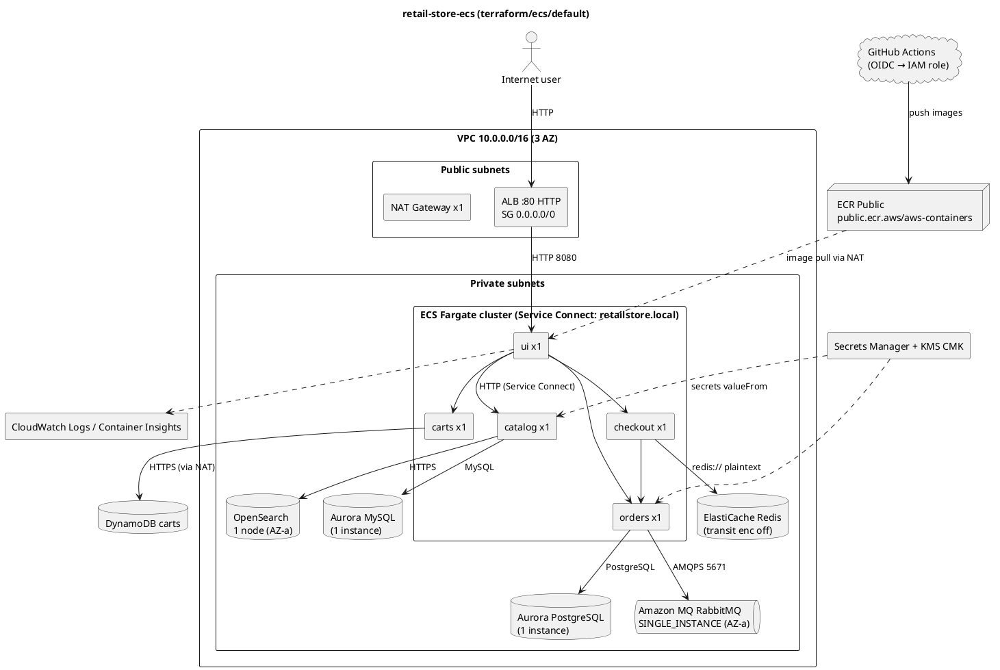

# Well-Architected Review: retail-store-ecs（Quick Review）

> **Classification: CONFIDENTIAL** — この報告書には、インフラ構成の詳細と未対処のセキュリティ指摘が含まれます。閲覧は権限のある関係者に限定してください。明示的な承認なしに、広く閲覧できるチャンネルやチケットシステムへ掲載しないでください。

## Coverage Audit

- レビューモード: Quick（質問単位の評価。個々の BP ページは取得していない）
- 評価した質問数: 57 / 57
- 評価した BP 数: 0 / 307（Quick モードのため BP 単位の台帳は作成していない。指摘で引用した BP ID はすべて凍結済みマニフェストから転記した）
- フレームワークの取得元: ACQUIRE_CORPUS で取得したライブドキュメント
- コーパスの出典: https://docs.aws.amazon.com/wellarchitected/latest/framework/toc-contents.json（2026-10-20T15:47:20Z UTC 取得、aws___read_documentation 経由、検証結果 valid）
- 柱: 6 · 質問: 57 · ベストプラクティス: 307
- 質問ごとの判定の内訳: Implemented 2、Partially Implemented 31、Not Implemented 10、Not Applicable 0、Cannot Determine 14

## Executive Summary

- **日付**: 2026-10-20
- **ワークロード**: retail-store-ecs
- **重要度**: standard
- **適用レンズ**: General
- **分析したパッケージ**: `terraform/ecs/default`、`terraform/lib/{ecs,ecs/service,dependencies,vpc,tags,images}`、`.github/workflows/*`、`src/{ui,catalog,cart,orders,checkout}`（Dockerfile とアプリケーション設定を含む）
- **評価した質問**: 57/57
- **指摘**: Critical 0、High 5、Medium 11、Low 8
- **総合成熟度**: 2 / 5。基盤はしっかりしている（IaC、プライベートサブネット、Secrets Manager、Service Connect、Container Insights、OIDC による CI 認証）。一方で、すべてのコンポーネントが単一インスタンスで、HTTP のみで公開され、アラームがない。

retail-store-ecs は、ECS Fargate 上の 5 つのマイクロサービスを Aurora、DynamoDB、ElastiCache、Amazon MQ、OpenSearch とともに Terraform で一括構築する。タスクはプライベートサブネットに置かれ、パブリック IP は割り当てられない（`terraform/lib/ecs/service/ecs.tf:145-149`）。DB の認証情報は Secrets Manager から `valueFrom` で注入される（`terraform/lib/ecs/catalog.tf:23-29`）。Aurora と OpenSearch は保存時に暗号化される。GitHub Actions から AWS へは OIDC で一時認証情報を得る（`.github/workflows/artifacts.yaml:34-39`）。ここまでは良い出発点である。

主要なリスクは次の 3 つ。

1. **公開 ALB の先にある UI が、認証なしでプロセス終了やファイル書き込みのエンドポイントを公開している**（`/utility/panic` など）。インターネットから誰でも UI を落とせる。
2. **可用性とデータ保護**。ECS サービスの desired_count が 1、Aurora と MQ と OpenSearch と Redis がいずれも単一インスタンスまたは単一 AZ で、DB の最終スナップショットも取らない設定になっている。AZ 障害や誤操作に耐えられない。
3. **検知できない**。CloudWatch アラームがひとつも定義されておらず、ALB は HTTP のみで WAF もない。

重要度が standard なので、マルチリージョン DR は求めない。単一リージョン内のマルチ AZ 化とアラーム整備を優先すべきである。

## Architecture Overview

- **入口**: インターネット → ALB（HTTP:80）→ ui → 各バックエンド。サービス間は ECS Service Connect（`terraform/lib/ecs/service/ecs.tf:151-162`）。
- **データストア**: catalog は Aurora MySQL と OpenSearch、carts は DynamoDB、checkout は Redis、orders は Aurora PostgreSQL と RabbitMQ。
- **デプロイ**: アプリケーションのイメージは release-please のリリース時に ECR Public へ公開される（`.github/workflows/release-please.yml:23-29`）。インフラは README に従い手動で `terraform apply` する（`terraform/ecs/default/README.md:26-32`）。

## Pillar Scorecard

| 柱 | スコア (1-5) | 評価した質問 | 主な強み | 主なギャップ |
|---|---|---|---|---|
| Operational excellence | 2 | 11/11 | IaC で全体を構築。Container Insights（enhanced）が既定で有効。PR で lint とテストを実行 | アラームがない。デプロイが手動。OTel が既定で無効 |
| Security | 2 | 11/11 | タスクはプライベートサブネットに配置。Secrets Manager で認証情報を注入。CI は OIDC。コンテナは非 root で実行 | 認証のない破壊的エンドポイント。HTTP のみで WAF なし。タスク SG が 0.0.0.0/0 |
| Reliability | 2 | 13/13 | 3 AZ の VPC。ALB とコンテナのヘルスチェック。Fargate による自己修復。カオス用フックと負荷テスト | すべて単一インスタンス。バックアップが手薄。タイムアウトとサーキットブレーカーがない |
| Performance efficiency | 3 | 5/5 | 用途別のデータストア（DynamoDB、Aurora、Redis、OpenSearch）を使い分け。マネージドサービス中心 | タスクサイズが固定。オートスケーリングがない |
| Cost optimization | 2 | 11/11 | NAT を 1 つに抑えている。OpenSearch は Graviton（r8g） | 予算やコスト配分タグがない。Fargate が x86。サイズが過大の可能性 |
| Sustainability | 3 | 6/6 | マネージドサービスを活用。arm64 イメージをすでにビルドしている | 需要に合わせたスケーリングがない。ログ保持期限がない |

## Per-Question Assessment

| ID | 質問 | 判定 | リスク | 主な根拠 |
|---|---|---|---|---|
| OPS01 | 優先順位をどう決めるか | Cannot Determine | — | 組織プロセスはコードから判断できない。ヒアリングが必要 |
| OPS02 | 組織構造 | Cannot Determine | — | 同上 |
| OPS03 | 組織文化 | Cannot Determine | — | 同上（`CONTRIBUTING.md` があることは確認） |
| OPS04 | オブザーバビリティの実装 | Partially Implemented | Medium | Container Insights は既定で enhanced（`terraform/ecs/default/variables.tf:28-31`）。Prometheus（`src/ui/src/main/resources/application.yml:74`）。OTel は既定で無効（`terraform/ecs/default/variables.tf:22-26`）。ヘルスチェックは依存先を確認しない（`src/catalog/main.go:138-145`）。ログは構造化されていない |
| OPS05 | 欠陥の削減と本番への流れ | Partially Implemented | Medium | PR で build/lint/test を実行（`.github/workflows/pr.yaml:49-57`）。tflint を実行（`lefthook.yml`）。Renovate を使用。一方、ECS の Terraform の lint と integration は `exit 0`（`terraform/ecs/default/project.json:25-38`） |
| OPS06 | デプロイリスクの軽減 | Partially Implemented | Medium | `wait_for_steady_state = true`（`terraform/lib/ecs/service/ecs.tf:143`）。デプロイサーキットブレーカー、自動ロールバック、Blue/Green がない |
| OPS07 | 運用準備の確認 | Cannot Determine | — | ランブックやプレイブックはリポジトリにない。運用体制のヒアリングが必要 |
| OPS08 | オブザーバビリティの活用 | Not Implemented | High | `aws_cloudwatch_metric_alarm` やダッシュボードの定義がない（terraform 全体を grep して確認） |
| OPS09 | 運用の健全性の把握 | Cannot Determine | — | 運用 KPI が定義されていない。ヒアリングが必要 |
| OPS10 | イベント管理 | Not Implemented | High | アラームと通知の経路（SNS など）がない。ライフサイクルイベントの転送は既定で無効（`terraform/ecs/default/variables.tf:38-46`） |
| OPS11 | 運用の進化 | Cannot Determine | — | 振り返りのプロセスはコードから判断できない |
| SEC01 | 安全な運用 | Partially Implemented | Medium | Renovate による依存関係の更新（`renovate.json`）。アカウント統制（Organizations、SCP）は対象外のため判断できない |
| SEC02 | 認証 | Partially Implemented | High | CI は OIDC（`.github/workflows/artifacts.yaml:34-39`）。タスクロールを使用。エンドユーザーの認証はなく、管理系エンドポイントも認証なしで公開（`src/ui/.../web/UtilityController.java:108-114`） |
| SEC03 | 権限管理 | Partially Implemented | Medium | `dynamodb:*`（`terraform/lib/dependencies/dynamodb.tf:42`）。checkout に carts テーブルの権限を付与（`terraform/lib/ecs/checkout.tf:21-23`）。OpenSearch のアクセスポリシーが `Principal = "*"`（`terraform/lib/dependencies/catalog_opensearch.tf:85-88`、FGAC と VPC で緩和） |
| SEC04 | セキュリティイベントの検知 | Not Implemented | Medium | ALB アクセスログがない（`terraform/lib/ecs/alb.tf:16-55`）。VPC フローログがない（`terraform/lib/vpc/vpc.tf:11-39`）。GuardDuty と CloudTrail はスコープ外 |
| SEC05 | ネットワーク保護 | Partially Implemented | High | 公開とプライベートでレイヤーを分離。DB 類は SG を参照してアクセスを許可。一方、WAF がなく、ALB は 0.0.0.0/0:80（`terraform/lib/ecs/alb.tf:9-10`）、タスク SG も 0.0.0.0/0:8080（`terraform/lib/ecs/service/sg.tf:5-10`） |
| SEC06 | コンピュート保護 | Partially Implemented | Medium | 非 root で実行（`src/ui/Dockerfile:68`）。一方、`readonlyRootFilesystem = false`（`terraform/lib/ecs/service/ecs.tf:61`）。全サービスで ECS Exec が有効（`terraform/lib/ecs/service/ecs.tf:142`）。サイドカーが `:latest`（`terraform/lib/ecs/service/ecs.tf:86`） |
| SEC07 | データ分類 | Not Implemented | Low | 分類タグがない（`terraform/lib/tags/main.tf:7-10`） |
| SEC08 | 保存データの保護 | Partially Implemented | Medium | Aurora と OpenSearch は暗号化済み（`terraform/lib/dependencies/catalog_rds.tf:23`、`terraform/lib/dependencies/catalog_opensearch.tf:68-70`）。KMS キーのローテーションがない（`terraform/lib/ecs/common.tf:1-4`）。orders と MQ のシークレットは CMK を使わない（`terraform/lib/ecs/orders.tf:68-70`、`terraform/lib/ecs/common.tf:11-13`）。ロググループは暗号化されていない |
| SEC09 | 転送中データの保護 | Partially Implemented | High | ALB は HTTP のみ（`terraform/lib/ecs/alb.tf:28-34`）。Redis の `transit_encryption_enabled = false`（`terraform/lib/dependencies/elasticache.tf:9`）。OpenSearch は TLS 1.2 を強制（`terraform/lib/dependencies/catalog_opensearch.tf:76-79`）。MQ は 5671/AMQPS |
| SEC10 | インシデント対応 | Cannot Determine | — | IR プレイブックは見当たらない。ヒアリングが必要 |
| SEC11 | アプリケーションセキュリティ | Partially Implemented | High | 公開経路から `/utility/*`、`/proxy/**`、`/chaos/*` に認証なしで到達できる。CI に SAST やイメージスキャンがない。checkout は `ValidationPipe` で入力を検証（`src/checkout/src/main.ts:31`） |
| REL01 | クォータ管理 | Cannot Determine | — | クォータの監視は定義されていない。アカウントのクォータ値の確認が必要 |
| REL02 | ネットワークトポロジー | Partially Implemented | Medium | 3 AZ のサブネット（`terraform/lib/vpc/vpc.tf:1-5`）。`single_nat_gateway = true`（`terraform/lib/vpc/vpc.tf:25`）で NAT が単一障害点 |
| REL03 | サービスアーキテクチャ | Implemented | — | 5 つのマイクロサービスを ECS サービス単位で分離。Service Connect を使用 |
| REL04 | 障害を防ぐ分散設計 | Partially Implemented | Medium | checkout が冪等キーなしで注文を作成（`src/checkout/.../checkout.service.ts:103-112`）。RabbitMQ キューが non-durable（`src/orders/.../RabbitMQMessagingConfig.java:76`） |
| REL05 | 障害を緩和する分散設計 | Partially Implemented | Medium | タイムアウトとサーキットブレーカーがない（`src/ui/.../config/StoreServices.java:74-77`）。リトライのバックオフが 1000 秒になるバグ（`src/ui/.../util/RetryUtils.java:31,40`） |
| REL06 | リソース監視 | Partially Implemented | High | メトリクスは収集されるが、アラームと通知がない |
| REL07 | 需要変化への適応 | Not Implemented | Medium | `desired_count = 1` で固定（`terraform/lib/ecs/service/ecs.tf:140`）。Application Auto Scaling がない。負荷テストは CI にある（`.github/workflows/e2e-test.yml:56-59`） |
| REL08 | 変更の実装 | Partially Implemented | Medium | イメージは不変でタグ固定（`terraform/lib/images/generated.tf.json`）。Terraform の適用は手動で、state の backend が定義されていない |
| REL09 | バックアップ | Partially Implemented | High | `skip_final_snapshot = true`（`terraform/lib/dependencies/orders_rds.tf:24`、`terraform/lib/dependencies/catalog_rds.tf:25`）。DynamoDB の PITR がない（`terraform/lib/dependencies/dynamodb.tf:1-28`）。AWS Backup がない |
| REL10 | 障害の分離 | Partially Implemented | High | VPC は 3 AZ。ただし各サービスは 1 タスク、Aurora は 1 インスタンス（`terraform/lib/dependencies/orders_rds.tf:10-12`）、MQ は単一インスタンス（`terraform/lib/dependencies/mq.tf:18-19`）、OpenSearch は 1 ノードで単一サブネット（`terraform/lib/dependencies/catalog_opensearch.tf:41-56`） |
| REL11 | コンポーネント障害への耐性 | Partially Implemented | High | ECS がタスクを自己修復。ALB とコンテナのヘルスチェック（`terraform/lib/ecs/alb.tf:43-52`、`terraform/lib/ecs/service/ecs.tf:67-73`）。フェイルオーバー先がない |
| REL12 | 信頼性のテスト | Partially Implemented | Low | カオス用エンドポイント、E2E、負荷テスト、トレースの検証が CI にある（`.github/workflows/e2e-test.yml:33-67`）。AWS 上での障害注入（FIS）はない |
| REL13 | DR 計画 | Not Implemented | Medium | RTO と RPO が定義されていない。復旧手順もない |
| PERF01 | リソースとアーキテクチャの選定 | Partially Implemented | Low | 用途別のマネージドサービスを選定。性能要件との突き合わせはない |
| PERF02 | コンピュートの選定 | Partially Implemented | Low | 全サービスが 1 vCPU / 2 GB で固定（`terraform/lib/ecs/service/ecs.tf:130-131`）。Graviton を使っていない |
| PERF03 | データの保存とアクセス | Implemented | — | DynamoDB、Aurora、Redis、OpenSearch を用途別に使い分け。コネクションプールは既定値 |
| PERF04 | ネットワーク | Partially Implemented | Low | Service Connect と ALB。静的アセット向けの CloudFront や VPC エンドポイントはない |
| PERF05 | 組織の慣行 | Cannot Determine | — | ヒアリングが必要 |
| COST01 | クラウド財務管理 | Cannot Determine | — | 組織プロセス |
| COST02 | 利用の統制 | Not Implemented | Low | Budgets などのコスト統制が IaC にない |
| COST03 | コストと利用の監視 | Partially Implemented | Low | タグは `environment-name` と `created-by` のみ（`terraform/lib/tags/main.tf:7-10`） |
| COST04 | リソースの廃止 | Partially Implemented | Low | `terraform destroy` で一括削除できる。廃止の基準はない |
| COST05 | サービス選定時のコスト評価 | Partially Implemented | Low | マネージドサービスを活用。コストモデルはない |
| COST06 | タイプ・サイズ・数の選定 | Partially Implemented | Low | `mq.m5.large`（`terraform/lib/dependencies/mq.tf:17`）とタスクサイズが固定。根拠となるデータがない |
| COST07 | 料金モデルの活用 | Not Implemented | Low | Fargate Spot や Savings Plans の検討がない |
| COST08 | データ転送 | Partially Implemented | Low | NAT は 1 つ。ECR、DynamoDB、Secrets Manager への通信はすべて NAT を経由する（VPC エンドポイントがない） |
| COST09 | 需要と供給の管理 | Not Implemented | Low | スケーリングがない（REL07 と同じ） |
| COST10 | 新サービスの評価 | Cannot Determine | — | プロセス。Renovate による更新はある |
| COST11 | 作業コストの評価 | Cannot Determine | — | プロセス |
| SUS01 | リージョン選定 | Cannot Determine | — | provider にリージョンが指定されていない（`terraform/ecs/default/versions.tf:12-13`）。実行時の設定に依存 |
| SUS02 | 需要への整合 | Not Implemented | Low | 常時 1 タスク。夜間停止などもない |
| SUS03 | ソフトウェアとアーキテクチャ | Partially Implemented | Low | 非同期のメッセージングを一部で使用。ポーリングの最適化などは判断できない |
| SUS04 | データ管理 | Partially Implemented | Low | CloudWatch Logs の保持期限が未設定（`terraform/lib/ecs/cluster.tf:10-12`） |
| SUS05 | ハードウェアとサービス | Partially Implemented | Low | OpenSearch は r8g（Graviton）。Fargate は x86 が既定で、`db.t3`/`cache.t3` は旧世代 |
| SUS06 | 組織プロセス | Cannot Determine | — | ヒアリングが必要 |

## Critical and High Risk Findings

### H-1 認証のない管理・カオス用エンドポイントが公開経路から到達できる（Security）

- **関連 BP**: SEC11-BP02 Automate testing throughout the development and release lifecycle、SEC02-BP01 Use strong sign-in mechanisms、SEC05-BP03 Implement inspection-based protection
- **内容**: ui の `UtilityController` には `/utility/panic`（`System.exit` を呼ぶ、`src/ui/src/main/java/com/amazon/sample/ui/web/UtilityController.java:108-121`）、`/utility/store`（`/tmp` に任意の内容を書き込む、同ファイル `:133-142`）、`/utility/stress/{n}`（CPU を消費する、同ファイル `:61-65`）がある。いずれも認証なしである。`ProxyController`（`src/ui/.../web/ProxyController.java:32`）は内部サービスの GET API を外部に中継する。actuator の `metrics` と `prometheus` も公開されている（`src/ui/src/main/resources/application.yml:74`）。ALB は 0.0.0.0/0 からのすべてのパスを ui に転送する（`terraform/lib/ecs/alb.tf:9-10,28-34`）。
- **影響評価**: Severe × Medium = **High**。ui は 1 タスクしかないため（`terraform/lib/ecs/service/ecs.tf:140`）、`/utility/panic` を繰り返し呼ぶだけでストアフロント全体を停止させ続けられる。パスはソースから簡単に分かる。
- **推奨**:
  1. ALB リスナールールで `/utility/*`、`/chaos/*`、`/actuator/*`（health 以外）、`/proxy/*` を 403 にする（最短で対処できる）。
  2. アプリ側では、これらのエンドポイントを Spring のプロファイル（例: `chaos`）を有効にしたときだけ登録する。
  3. AWS WAF の Core rule set とレートベースルールを ALB に関連付ける。
- **工数**: 小（ALB ルールなら 1 日）。**AWS サービス**: ALB、AWS WAF。

### H-2 ALB が HTTP のみで WAF もなく、Redis の通信も平文（Security）

- **関連 BP**: SEC09-BP02 Enforce encryption in transit、SEC09-BP01 Implement secure key and certificate management、SEC05-BP03 Implement inspection-based protection
- **内容**: リスナーは HTTP:80 だけで（`terraform/lib/ecs/alb.tf:28-34`）、出力される URL も `http://`（`terraform/lib/ecs/outputs.tf:3`）。checkout フォームは配送先と支払い情報を受け付ける（`src/ui/.../PaymentDetailsRequest.java`）。セッション Cookie には Secure、HttpOnly、SameSite がない（`src/ui/.../web/util/SessionIDUtil.java:39-42`）。セキュリティヘッダー（CSP、HSTS など）もない。Redis は `transit_encryption_enabled = false`（`terraform/lib/dependencies/elasticache.tf:9`）で、接続 URL は `redis://`（`terraform/lib/ecs/checkout.tf:17`）。
- **影響評価**: Severe × Medium = **High**。経路上で個人情報とセッションを盗聴、改ざんされる可能性がある。
- **推奨**: ACM 証明書を使った HTTPS:443 リスナーを追加し、HTTP は 301 で HTTPS へリダイレクトする。セキュリティポリシーは `ELBSecurityPolicy-TLS13-1-2-2021-06` 以上にする。CSP、HSTS、X-Frame-Options、X-Content-Type-Options、Referrer-Policy、Permissions-Policy のヘッダーと Cookie 属性を付与する。Redis は TLS と AUTH（または RBAC）を有効にし、`rediss://` で接続する。
- **工数**: 中（2〜3 日、ドメインと証明書の準備を含む）。**AWS サービス**: ACM、ALB、AWS WAF、ElastiCache。

### H-3 すべてのコンポーネントが単一インスタンスまたは単一 AZ（Reliability）

- **関連 BP**: REL10-BP01 Deploy the workload to multiple locations、REL11-BP02 Fail over to healthy resources、REL02 関連（単一 NAT）
- **内容**:
  - ECS: 各サービスが `desired_count = 1`（`terraform/lib/ecs/service/ecs.tf:140`）
  - Aurora: 両クラスターとも `instances = { one = {} }`（`terraform/lib/dependencies/catalog_rds.tf:11-13`、`terraform/lib/dependencies/orders_rds.tf:10-12`）
  - Amazon MQ: `SINGLE_INSTANCE` を `subnet_ids[0]` に配置（`terraform/lib/dependencies/mq.tf:18-19`）
  - OpenSearch: 1 ノード、`zone_awareness_enabled = false`、単一サブネット（`terraform/lib/dependencies/catalog_opensearch.tf:41-56`）
  - ElastiCache: レプリカとフェイルオーバーが明示されていない（`terraform/lib/dependencies/elasticache.tf:1-13`、モジュール既定値に依存。plan で要確認）
  - NAT ゲートウェイ: 1 つ（`terraform/lib/vpc/vpc.tf:25`）
- **影響評価**: Severe × Low = **High**。AZ-a の障害で注文（MQ）、検索（OpenSearch）、外部通信（NAT）が同時に止まる。Aurora のフェイルオーバー先もない。
- **推奨**（standard 重要度なので単一リージョン内のマルチ AZ 化で十分）:
  - ECS は `desired_count >= 2`。AZ への分散は Fargate の既定動作に任せる。
  - Aurora はリーダーインスタンスを 1 台追加する。
  - MQ は `CLUSTER_MULTI_AZ` にする。
  - OpenSearch は 2 ノード以上で zone awareness を有効にする。
  - Redis はレプリカ 1 台と自動フェイルオーバーを有効にする。
  - NAT は AZ ごとに配置する（`single_nat_gateway = false`。コストとのトレードオフは後述）。
- **工数**: 中（1〜2 週間、段階的に実施）。**AWS サービス**: ECS、Aurora、Amazon MQ、OpenSearch Service、ElastiCache、VPC。

### H-4 バックアップと復旧の設計が不十分（Reliability）

- **関連 BP**: REL09-BP01 Identify and back up all data that needs to be backed up, or reproduce the data from sources、REL09-BP03 Perform data backup automatically、REL09-BP04 Perform periodic recovery of the data to verify backup integrity and processes
- **内容**: 両 Aurora クラスターとも `skip_final_snapshot = true`（`terraform/lib/dependencies/orders_rds.tf:24`、`terraform/lib/dependencies/catalog_rds.tf:25`）で、`backup_retention_period` を明示していない（モジュール既定値に依存）。DynamoDB の carts テーブルは PITR がない（`terraform/lib/dependencies/dynamodb.tf:1-28`）。AWS Backup のプランも、復元テストもない。
- **影響評価**: Severe × Low = **High**。`terraform destroy` や置き換え操作で、注文データが最終スナップショットなしに消える。
- **推奨**: `skip_final_snapshot = false` と `backup_retention_period = 7`（以上）を明示する。DynamoDB で `point_in_time_recovery_enabled = true` を設定する。Aurora と DynamoDB を AWS Backup のプランで保護し、四半期に 1 回復元テストを行う。
- **工数**: 小〜中。**AWS サービス**: AWS Backup、Aurora、DynamoDB。

### H-5 アラームと通知がない（Operational excellence / Reliability）

- **関連 BP**: OPS08-BP04 Create actionable alerts、REL06-BP03 Send notifications (Real-time processing and alarming)、REL11-BP06 Send notifications when events impact availability
- **内容**: Terraform のどこにも `aws_cloudwatch_metric_alarm`、SNS トピック、ダッシュボードの定義がない（grep で確認）。Container Insights（`terraform/lib/ecs/cluster.tf:4-7`）がメトリクスを集めても、誰にも通知されない。ECS のライフサイクルイベントを転送する設定は既定で無効（`terraform/ecs/default/variables.tf:38-46`）。
- **影響評価**: Moderate × High = **High**。H-1 や H-3 の障害が起きても検知が遅れ、MTTR が伸びる。
- **推奨**: 最低限、次のアラームを SNS（KMS で暗号化したトピック）経由で通知する。
  - ALB の `HTTPCode_Target_5XX_Count`、`TargetResponseTime` p99、`UnHealthyHostCount`
  - ECS の `RunningTaskCount < desired`
  - Aurora の `CPUUtilization` と `FreeableMemory`
  - MQ と OpenSearch のクラスター状態

  あわせて CloudWatch ダッシュボードを 1 枚作り、`lifecycle_events_enabled = true` を既定にする。
- **工数**: 小（2〜3 日）。**AWS サービス**: CloudWatch、Amazon SNS、EventBridge。

## Medium Risk Findings

| ID | 柱 | 指摘 | 根拠 | 推奨 |
|---|---|---|---|---|
| M-1 | Reliability | タイムアウト、サーキットブレーカー、冪等性がない。リトライのバックオフにバグがある | `src/ui/.../config/StoreServices.java:74-77`（既定の OkHttp）、`src/ui/.../util/RetryUtils.java:31,40`（`Duration.ofSeconds(1000)` で 1000 秒）、`src/checkout/.../orders/HttpOrdersService.ts:30-47`（fetch にタイムアウトがない）、`src/checkout/.../checkout.service.ts:103-112`（冪等キーがない）、`src/orders/.../RabbitMQMessagingConfig.java:76`（non-durable キュー、DLQ がない）、outbox がない（`src/orders/.../OrdersEventHandler.java:38-41`） | REL05-BP05（クライアントタイムアウト）、REL05-BP03（リトライの制御）、REL04 系の冪等化。`Duration.ofMillis` に修正し、Resilience4j を導入し、キューを durable にして DLQ を設ける |
| M-2 | Security | 最小権限になっていない IAM | `dynamodb:*`（`terraform/lib/dependencies/dynamodb.tf:42`）、checkout に carts の権限（`terraform/lib/ecs/checkout.tf:21-23`）、`ssmmessages:*` が `Resource *`（`terraform/lib/ecs/service/iam.tf:126-133`）、OpenSearch が `Principal *`（`terraform/lib/dependencies/catalog_opensearch.tf:85-88`） | SEC03-BP02。アクションを Get/Put/Update/Delete/Query に絞る。checkout から carts の権限を外す。OpenSearch のポリシーを catalog タスクロールに限定する |
| M-3 | Security | タスク SG が 0.0.0.0/0:8080 を許可している | `terraform/lib/ecs/service/sg.tf:5-10` | SEC05-BP02。ui は ALB の SG から、その他は呼び出し元サービスの SG からのみ許可する |
| M-4 | Security | 保存時の暗号化の一貫性 | KMS キーのローテーションがない（`terraform/lib/ecs/common.tf:1-4`）、orders と MQ のシークレットが CMK を使わない（`terraform/lib/ecs/orders.tf:68-70`、`terraform/lib/ecs/common.tf:11-13`）、ロググループに KMS がない（`terraform/lib/ecs/cluster.tf:10-12`）、Redis の保存時暗号化はモジュール既定値に依存 | SEC08-BP01。`enable_key_rotation = true` を設定し、すべてのシークレットとロググループに CMK を使い、`at_rest_encryption_enabled = true` を明示する |
| M-5 | Operational excellence / Reliability | デプロイの安全策が弱い | ECS にデプロイサーキットブレーカーとロールバックがない（`terraform/lib/ecs/service/ecs.tf:136-175`）。Terraform は手動適用で backend が定義されていない（`terraform/ecs/default/versions.tf`）。lint と integration は `exit 0`（`terraform/ecs/default/project.json:25-38`） | OPS06-BP03、OPS06-BP04、REL08-BP05。`deployment_circuit_breaker { enable = true, rollback = true }`、S3 backend と state のロック、plan と apply を CI のパイプラインで実行 |
| M-6 | Security | コンピュートの堅牢化 | `readonlyRootFilesystem = false`（`terraform/lib/ecs/service/ecs.tf:61`）、全サービスで ECS Exec が有効だが監査ログの設定がない（`terraform/lib/ecs/service/ecs.tf:142`）、`cloudwatch-agent:latest`（`terraform/lib/ecs/service/ecs.tf:86`）、イメージがダイジェストで固定されていない | SEC06-BP02、SEC06-BP03、SEC06-BP04。読み取り専用のルートと tmpfs、ECS Exec は必要なときだけ有効にしログを記録、イメージをバージョンまたはダイジェストで固定 |
| M-7 | Reliability / Cost | オートスケーリングがない | `terraform/lib/ecs/service/ecs.tf:140`。`aws_appautoscaling_*` がない | REL07-BP01、REL07-BP03。CPU または ALB の RequestCountPerTarget を基準に、min 2 / max N のターゲット追跡スケーリングを設定 |
| M-8 | Operational excellence | オブザーバビリティの既定値が弱い | OTel が既定で無効（`terraform/ecs/default/variables.tf:22-26`）。ログが構造化されていない。ヘルスチェックが依存先を確認しない（`src/catalog/main.go:138-145`、`src/checkout/.../app.controller.ts:32-38`）。ログの保持期限がない（`terraform/lib/ecs/cluster.tf:10-12`） | OPS04-BP02、OPS04-BP04、OPS04-BP05。OTel を既定で有効にし、JSON 形式でログを出し、readiness で依存先を確認し、`retention_in_days` を設定 |
| M-9 | Security | 検知用のログがない | ALB アクセスログ（`terraform/lib/ecs/alb.tf:16-55`）、VPC フローログ（`terraform/lib/vpc/vpc.tf:11-39`） | SEC04 系。ALB アクセスログを S3（SSE-KMS とパブリックアクセスブロック）に出力し、`enable_flow_log = true` を設定。GuardDuty（ECS Runtime Monitoring）の有効化も検討 |
| M-10 | Security | CI にセキュリティテストがない | `.github/workflows/pr.yaml:39-57` に SAST、依存関係スキャン、イメージスキャンがない。Actions がタグ参照（`actions/checkout@v3` など） | SEC11-BP02、SEC11-BP07。CodeQL、Trivy、または ECR Enhanced Scanning を追加し、Actions をコミット SHA で固定 |
| M-11 | Reliability | DR の目標が定義されていない | RTO と RPO の記述、復旧手順がない | REL13 系。standard 重要度なので、単一リージョンでのバックアップと復元を前提に RTO と RPO を文書化し、復元を演習する |

## Low Risk Findings

| ID | 柱 | 指摘 | 推奨 |
|---|---|---|---|
| L-1 | Cost / Sustainability | Fargate が x86 のまま。arm64 イメージはすでにビルドしている（`.github/workflows/artifacts.yaml:21-25`） | タスク定義に `runtime_platform { cpu_architecture = "ARM64" }` を設定 |
| L-2 | Cost | サイズの根拠がない（`mq.m5.large`、すべてのタスクが 1 vCPU / 2 GB、`db.t3`/`cache.t3`） | Container Insights のデータを基に適正化し、t4g や Graviton 系へ移行 |
| L-3 | Cost / Performance | VPC エンドポイントがなく、ECR、DynamoDB、Secrets Manager への通信が NAT を経由 | DynamoDB と S3 のゲートウェイエンドポイント、ECR と Secrets Manager のインターフェイスエンドポイントを追加 |
| L-4 | Cost | コスト配分タグと予算がない（`terraform/lib/tags/main.tf:7-10`） | `cost-center` や `owner` タグを付与し、AWS Budgets のアラートを設定 |
| L-5 | Operational excellence | README と実装がずれている。存在しない `log_group_retention_days` が記載され、Container Insights の既定値も実装と違う（`terraform/ecs/default/README.md:52-54` と `terraform/ecs/default/variables.tf:28-31`） | README を修正し、terraform-docs で自動生成 |
| L-6 | Reliability | `apply_immediately = true` と `allow_major_version_upgrade = true`（`terraform/lib/dependencies/catalog_rds.tf:9,24`） | メンテナンスウィンドウ内での適用に変更 |
| L-7 | Security | データ分類タグがない | `data-classification` タグを定義 |
| L-8 | Cost | 料金モデルを活用していない | 非本番環境で Fargate Spot のキャパシティプロバイダーを使い、Compute Savings Plans を評価 |

## Cross-Pillar Trade-offs

| トレードオフ | 内容 | 推奨する解決 |
|---|---|---|
| 信頼性 ↔ コスト | H-3 のマルチ AZ 化（NAT を 3 つ、MQ をクラスター化、Aurora のリーダー、OpenSearch を 2 ノード）でコストが大きく増える | 重要度は standard なので、まず ECS を 2 タスクに、Aurora にリーダーを追加する（データ損失と停止に直結する部分）。MQ と OpenSearch は次の段階で対応する。NAT の増加分は L-3 の VPC エンドポイントによる転送料金の削減で一部相殺する |
| セキュリティ ↔ コスト / 性能 | WAF、TLS、ALB アクセスログ、KMS は少額の固定費とわずかな遅延を加える | 公開ワークロードでは必須の範囲なので受け入れる |
| コスト ↔ 信頼性 | M-7 のオートスケーリングを min 2 にすると常時費用が倍になる | L-1（Graviton）と L-2（適正化）で単価を下げて吸収する |
| コスト ↔ 持続可能性 | Graviton 化と適正化は両方の柱に効く | L-1 と L-2 を同時に進める |

## Prioritize Improvements — Eisenhower Matrix

| 象限 | 方針 | 指摘 |
|---|---|---|
| **Do First**（重要度が高く工数が小さい） | すぐに実施 | H-1、H-4、H-5、M-3、M-5（サーキットブレーカー部分） |
| **Plan**（重要度が高く工数が大きい） | ロードマップに入れて段階的に実施 | H-2、H-3、M-1、M-7、M-8、M-10、M-11 |
| **Delegate**（重要度が低く工数が小さい） | まとめて担当者に割り当て | M-2、M-4、M-6、M-9、L-1、L-4、L-5、L-6、L-7 |
| **Defer**（重要度が低く工数が大きい） | 次の見直しで再検討 | L-2、L-3、L-8 |

## Prioritized Remediation Plan

### Quick Wins（1 週間以内）— Do First

| 指摘 | 対応 | SMART ゴール | 担当の目安 | 工数 |
|---|---|---|---|---|
| H-1 | ALB リスナールールで管理系パスを 403 にする | 2026-10-27 までに、外部から `/utility/panic` へのリクエストが 403 を返すことを curl で確認する | アプリ / インフラ | 0.5〜1 日 |
| H-4 | `skip_final_snapshot = false`、`backup_retention_period = 7`、DynamoDB の PITR | 2026-10-31 までに terraform plan の差分をマージし、Aurora の保持期間が 7 日になっていることをコンソールで確認する | インフラ | 1 日 |
| H-5 | ALB の 5XX、ECS の RunningTaskCount、Aurora の CPU を SNS で通知 | 2026-10-31 までに 5 つのアラームを作成し、テスト通知が届くことを確認する | SRE | 2 日 |
| M-3 | タスク SG を SG 参照に変更 | 2026-10-31 までに、0.0.0.0/0 を許可するタスク SG のインバウンドルールを 0 件にする | インフラ | 1 日 |
| M-5 | ECS のデプロイサーキットブレーカーと自動ロールバックを有効化 | 2026-10-31 までに、5 サービスすべてで `rollback = true` を確認する | インフラ | 0.5 日 |

### Foundation（1〜4 週間）— Plan

| 指摘 | 対応 | フェーズ | 工数 | 依存関係 |
|---|---|---|---|---|
| H-2 | HTTPS 化、WAF、セキュリティヘッダー、Redis の TLS | 1) ACM と HTTPS リスナー 2) WAF のマネージドルール 3) アプリのヘッダーと Cookie 4) Redis の TLS と AUTH | 1〜2 週間 | ドメインと証明書 |
| H-3（第 1 段階） | ECS を 2 タスクに、Aurora にリーダーを追加、Redis にレプリカ | 1) ECS 2) Aurora 3) Redis | 1 週間 | M-7 と同時に進めるのが望ましい |
| M-1 | タイムアウト、Resilience4j、バックオフのバグ修正、冪等キー、durable キューと DLQ | 1) バグ修正 2) タイムアウト 3) CB 4) 冪等性と DLQ | 2〜3 週間 | アプリチーム |
| M-7 | ターゲット追跡のオートスケーリング | 1) ui 2) その他 | 3 日 | H-3 |
| M-8 / M-10 | OTel の既定有効化、JSON ログ、readiness。CI に SAST とイメージスキャン | 段階的に実施 | 2 週間 | — |

### Strategic（1〜3 か月）— Plan（複雑）

| 指摘 | 対応 | フェーズ | 工数 | 依存関係 |
|---|---|---|---|---|
| H-3（第 2 段階） | MQ を `CLUSTER_MULTI_AZ` に、OpenSearch を zone awareness で 2 ノード以上に、NAT を AZ ごとに | MQ、OpenSearch、NAT の順に、各段階を可逆に保って実施 | 3〜4 週間 | コスト承認 |
| M-5（パイプライン化） | S3 backend、CI での plan と承認付き apply | 1) backend 2) plan の PR コメント 3) apply | 2〜3 週間 | IAM（OIDC） |
| M-11 | RTO と RPO の定義、AWS Backup、復元演習 | 1) 目標の定義 2) Backup プラン 3) 四半期ごとの演習 | 1 か月 | H-4 |

### Delegate（まとめて割り当て）

| 指摘 | 対応 | 担当の目安 | 工数 |
|---|---|---|---|
| M-2 | IAM のアクションとプリンシパルを絞る | インフラ | 1 日 |
| M-4 | KMS のローテーション、全シークレットとロググループへの CMK 適用 | インフラ | 1 日 |
| M-6 | readonlyRootFilesystem、ECS Exec の制限、イメージの固定 | インフラ / アプリ | 2 日 |
| M-9 | ALB アクセスログと VPC フローログ | インフラ | 0.5 日 |
| L-1 / L-4 / L-5 / L-6 / L-7 | ARM64 化、タグ、README、DB の変更適用タイミング、分類タグ | 誰でも | 各 0.5 日 |

### Deferred — 次回の見直しで再検討

- **L-2（適正化）**: H-3 と M-7 を実施した後のメトリクスで判断する方が正確なため、後回しにする。
- **L-3（VPC エンドポイント）**: NAT を AZ ごとに配置する判断（H-3 第 2 段階）と一緒に検討する。
- **L-8（料金モデル）**: 利用量が安定してから Savings Plans を評価する。

## Next Steps

1. ALB リスナールールで `/utility/*`、`/chaos/*`、`/proxy/*`、`/actuator/*`（health 以外）を遮断する（H-1）。
2. Aurora の `skip_final_snapshot = false` と保持期間の明示、DynamoDB の PITR を有効にする（H-4）。
3. ALB、ECS、Aurora の主要アラームを SNS 通知付きで作成する（H-5）。
4. タスク SG を SG 参照に絞り、ECS のデプロイサーキットブレーカーを有効にする（M-3、M-5）。
5. HTTPS 化と WAF の導入計画を立て、ドメインと ACM 証明書を準備する（H-2）。

---

**補足**: Quick モードでは質問単位で評価しており、307 の BP を個別には判定していない。BP 単位の台帳が必要な場合は Full レビューを実施する。モジュール既定値に依存する項目（Aurora の `backup_retention_period`、ElastiCache の保存時暗号化とレプリカ数）は、`terraform plan` の出力か実環境で確認すること。
